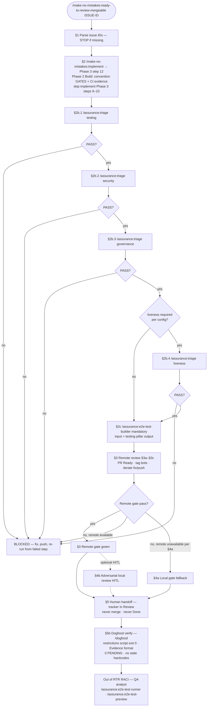

# Engineering standards — SSOT & pipeline

> SSOT at monorepo level: `shared/references/engineering-standards/`.
> Are you an agent? Reference these standards by monorepo-relative path
> (`shared/references/engineering-standards/<file>`) — never copy their text.
> The canonical index of the practices lives in `shared/references/engineering-standards/index.md`.

Portable baseline for any client startup. **Not a greenfield framework** — names and
enforces conventions already in industry use.

## Pipeline (end-to-end)

The full change pipeline — from tracker issue to human review handoff — is
orchestrated by `/ready-to-review-mergeable` (protocol:
`toolkits/make-no-mistakes-toolkit/references/ready-to-review-mergeable/protocol.md`).
**Invariant: never merge.** The merge itself happens after the handoff, executed
by a human, and is governed by MPH/NSQ/REL.

| Stage (in RTR) | Standard |
| --- | --- |
| Issue opening / redaction (Human + Agent, antes de abrir) | **BIB** |
| Tracker issue → change folder | **OST** |
| PR description + scope | **PRDS** |
| QA traceability (req → test) | **QT4L** |
| CI/security gates | **CIS** |
| Remote review gate | CI checks (green) |
| Exit = human handoff; never merge | RTR protocol (invariant) |
| **After** handoff — merge (human) | **MPH** · **NSQ** · **REL** · **GGT** |

## Index of practices (SSOT)

The canonical index of the practices lives in `shared/references/engineering-standards/index.md`.

| Sigla | Name | Scope | SSOT |
| --- | --- | --- | --- |
| **1. DSMS** | Domain-Sliced Module Structure | Where files live | `dsms-ifs-cps.md` §1 |
| **2. DDD** | Domain-Driven Design | Bounded contexts, ubiquitous language, aggregates; design guided by the domain | `domain-driven-design.md` |
| **3. IFS** | Intra-File Structure | How one file reads top-to-bottom | `dsms-ifs-cps.md` §2 |
| **4. CPS** | Categorized Public Surface | How public barrels export | `dsms-ifs-cps.md` §3 |
| **5. CCC** | Code Comment Convention | Meaningful non-obvious comments; no redundant "how" comments | `code-comment-convention.md` |
| **6. CLH** | Copyright/License Header | Headers per repo LICENSE.md; not a global rule | `copyright-license-header.md` |
| **7. CvC** | Conventional Commits | Commit message format `type(scope): description`; machine-readable history and changelog generation | `conventional-commits.md` |
| **8. CLG** | Commit Logic Groups | Commit intermediate work in semantic groups; each commit is self-contained and reviewable | `commit-logic-groups.md` |
| **9. PCH** | Pre-Commit Hooks | Vendored canonical pre-commit config + shared Mermaid validator; hooks enforced repo-wide | `pre-commit-hooks.md` |
| **10. PRDS** | Pull Request Description Standards | PR body + reviewable size | `prds.md` |
| **11. BrS** | Branching Strategy | Branches, naming, protection | `branching-strategy.md` |
| **12. WTD** | Worktree Discipline | Worktrees are transient and never committed. Parity (1 issue = 1 worktree = 1 PR) is an association policy, not persistence. | `worktree-discipline.md` |
| **13. Jidoka** | Stop-on-Anomaly | Stop on any anomaly; record the owning boundary and a root-cause hypothesis before continuing. Never "see if the rest works" after a failure. | `jidoka.md` |
| **14. StS** | Stderr/Stream Standards | Never send a stream to null; fold stderr into the same sink (`> out.log 2>&1` or `2>&1 \| tee run.log`); separate-file redirects are forbidden. | `stderr-stream-standards.md` |
| **15. GGT** | GitFlow + Trunk-based | Hybrid model: feature→`develop` rebase. `develop`→`main` merge commit. Auditable setup + repo-initial-setup step | `gitflow-trunk.md` |
| **16. QT4L** | QA Traceability (four layers) | Req → automated test → manual QA → HITL | `qa-traceability-four-layers.md` |
| **17. AFIF** | Anti-Fragility via Fault Injection | Harden every layer by injecting faults (mutation, formal self-test, chaos, gate negatives). "Never seen fail" is not a pass. | `anti-fragility-fault-injection.md` |
| **18. OST** | OpenSpec store PR traceability | Tracker → change folder → one store PR → one merge | `openspec-store-pr-traceability.md` |
| **19. RDP** | Repository Drift Prevention | Single source of truth per artifact; detect and prevent drift across repos/config | `repository-drift-prevention.md` |
| **20. CHH** | Checksum Hygiene | Setup scripts pin the VERSION and verify release assets against the release's own checksum manifest — never hardcoded sha256 constants | `checksum-hygiene.md` |
| **21. SemVer** | Semantic Versioning policy | Version source = plugin.json. The generator derives marketplace.json from it. The merge queue enforces a monotonic bump vs the default branch (rebase + re-bump). | `semver.md` |
| **22. MPH** | Main Protections & HITL Merge Guard | Default branch ruleset (only named team bypass) + org-wide 2FA + pre-tool-use guard that requires interactive human approval for any bypass/admin merge. Fail-closed. | `main-protections-hitl.md` |
| **23. BGI** | Build-Artifact Gitignore | Every repo vendors the ignore patterns from `vendored-gitignore.toml` (venv, node_modules, target, build, caches). Promotes the symlink build-artifact policy | `build-artifacts-gitignore.md` |
| **24. ODT** | Ops Documentation Taxonomy | Classify every ops doc as Playbook vs Runbook vs SOP. Never mix. Route via /document-this | `ops-documentation-taxonomy.md` |
| **25. NSQ** | No-Squash Merge | Every repo sets `allow_squash_merge: false`. Merge and rebase stay allowed. Rulesets exclude squash. The local guard blocks `--squash`. | `no-squash-merge.md` |
| **26. TFM** | Formal Model TLA+ | Standardized TLA+/TLC modeling and validation recipe | `formal-model-tla.md` |
| **27. CIS** | CI Security & Standards | Standardized CI security gates (CodeQL/Trivy/SAST), vendorized templates, traceable evidence | `ci-security-standards.md` |
| **28. REL** | Release Cut | One consolidated `develop`→`main` PR. CTO owns the QA audit (QT4L). A second human reviewer is the sole PROD gate. Hotfixes only via `hotfix/*`. | `release-cut.md` |
| **29. FFF** | Feature Flag Families | Two-level model: families (Release, Experimentation, Ops, Access, Decommissioning, Security vendorization) each with an internal taxonomy of subtypes. Interfaces with REL/MPH/GGT/DDD. | `feature-flag-families.md` |
| **30. LTGT** | Local Truth is not Ground Truth | A CWD shows one worktree's branch. Ground truth is the repo: `git rev-parse --git-common-dir`, `git worktree list`, `git ls-files`, with hidden paths included. Never conclude absence from a CWD-only scan. | `local-vs-ground-truth.md` |
| **31. no-deprecated-agent-shims** | No deprecated agent shims | Renames are clean-cut: update references and delete the old path; no "MOVED (shim)" or exec wrappers. | `no-deprecated-agent-shims.md` |
| **32. codeowners-replication** | CODEOWNERS replication | Org admin App workflow replicates CODEOWNERS; single source, no drift. | `codeowners-replication-workflow.md` |
| **33. BIB** | Bilingual Issue Brief | Every issue (GitHub o Linear) redactado en formato Bilingual ANTES de abrirlo — Human Layer + Agent Layer (HUMAN LAYER / AGENT LAYER / Acceptance Criteria / Context Files). Gate determinístico `shared/hooks/bilingual/detect.py`. | `bilingual-issue-brief.md` |
| **34. TAS** | Test Assertion Standards | Aserciones de contrato e invariantes, no snapshots: nunca conteos literales de registros que crecen; derivar del source of truth (p.ej. `NPM_PACKAGES.length`). | `test-assertion-standards.md` |

The **clean code quartet** is DSMS + IFS + CPS + PRDS. BrS + WTD govern branching
and worktree hygiene. QT4L and **OST** (when the client uses an OpenSpec store)
complete QA traceability and spec promotion discipline.

**Adoption order** (flowchart TD):

```mermaid
flowchart TD
    S0[DSMS — Domain-Sliced Module Structure]
    S1[DDD — Domain-Driven Design]
    S2[IFS — Intra-File Structure]
    S3[CPS — Categorized Public Surface]
    S4[CCC — Code Comment Convention]
    S5[CLH — Copyright/License Header]
    S6[CvC — Conventional Commits]
    S7[CLG — Commit Logic Groups]
    S8[PCH — Pre-Commit Hooks]
    S9[PRDS — PR Description Standards]
    S10[BrS — Branching Strategy]
    S11[WTD — Worktree Discipline]
    S12[Jidoka — Stop-on-Anomaly]
    S13[StS — Stderr/Stream Standards]
    S14[GGT — GitFlow + Trunk-based]
    S15[QT4L — QA Traceability, four layers]
    S16[AFIF — Anti-Fragility via Fault Injection]
    S17[OST — OpenSpec store PR traceability]
    S18[RDP — Repository Drift Prevention]
    S19[CHH — Checksum Hygiene]
    S20[SemVer — Semantic Versioning policy]
    S21[MPH — Main Protections & HITL]
    S22[BGI — Build-Artifact Gitignore]
    S23[ODT — Ops Documentation Taxonomy]
    S24[NSQ — No-Squash Merge]
    S25[TFM — Formal Model TLA+]
    S26[CIS — CI Security & Standards]
    S27[REL — Release Cut]
    S28[FFF — Feature Flag Families]
    S29[LTGT — Local Truth is not Ground Truth]
    S30[no-deprecated-agent-shims]
    S31[codeowners-replication]
    S32[BIB — Bilingual Issue Brief]
    S33[TAS — Test Assertion Standards]
    S0 --> S1 --> S2 --> S3 --> S4 --> S5 --> S6 --> S7 --> S8 --> S9
    S9 --> S10 --> S11 --> S12 --> S13 --> S14 --> S15
    S15 --> S16 --> S17 --> S18 --> S19 --> S20 --> S21 --> S22
    S22 --> S23 --> S24 --> S25 --> S26 --> S27 --> S28 --> S29
    S29 --> S30 --> S31 --> S32 --> S33
```

**Day-to-day priority:** IFS, PRDS, QT4L (reading rhythm, review rhythm, req→test trace), Jidoka, StS.

## Adoption policy

- **Incremental only** — apply when adding or materially editing code in that area. No mass legacy refactors for compliance.
- **Satellite repos** — client `AGENTS.md` links here. Do not duplicate full text in apps/packages.
- **Not a refactor license** — standards adoption does not authorize out-of-scope folder moves or barrel rewrites.

## Commands

| Command | Purpose |
| --- | --- |
| `/engineering-standards-setup` | Scaffold pointers + PR template + QT4L stub in a client repo (index of 32) |
| `/engineering-standards-audit` | Measure adoption (all 32, parallelizable per family). Audit open PRs when `--prs`. |

Protocol SSOT: `references/engineering-standards-setup/protocol.md`, `references/engineering-standards-audit/protocol.md`.

## Quick reference

| Question | Practice |
| --- | --- |
| Feature folder or `shared/`? | DSMS |
| Domain boundaries and ubiquitous language? | DDD |
| imports → types → main → helpers? | IFS |
| Banner on sections? | IFS (file) / CPS (barrel) |
| Public barrel export? | CPS |
| Comment intent, not "how"? | CCC |
| Conventional commit format? | CvC |
| Group commits semantically? | CLG |
| PR description and size? | PRDS |
| Pre-commit enforcement? | PCH |
| Branch naming and protection? | BrS |
| Worktree hygiene / parity? | WTD |
| Stop on anomaly? | Jidoka |
| stderr/stream discipline? | StS |
| Scenario → verification in tasks? | QT4L |
| One OpenSpec folder per store PR? | OST |
| Prevent drift across repos? | RDP |
| Hardcoded sha256 in a setup script? | CHH |
| How do I bump a plugin version? | SemVer (monotonic vs main, merge queue) |
| How do I protect `main` even from founders? | MPH (ruleset + 2FA + pre-tool-use fail-closed guard) |
| Which `.gitignore` patterns must I vendor? | BGI (catalog `vendored-gitignore.toml`) |
| Is it a playbook or a runbook? | ODT (taxonomy. Never mix) |
| How do I integrate features and releases? | GGT (feature→develop rebase. develop→main merge commit) |
| How do I cut a release (PROD)? | REL (one develop→main PR. CTO QA audit. second human reviewer = sole gate) |
| How do I gate release risk post-cut? | FFF (flags: kill switch, rollout, entitlement) |
| Where do I search for the truth? | LTGT (git common-dir + all worktrees + hidden paths. Never CWD-only) |
| How do I verify the order formally? | TFM (TLA+/TLC recipe) |
| How do I write tests that don't drift? | TAS (contrato/invariantes; nunca conteos literales de registros) |

## Provenance

Generalized from production SaaS platform process docs (multi-repo OpenSpec,
agent handoffs, and store PR traceability): `code-organization-standards`,
`pull-request-description-and-scope`, `branching-strategy`,
`qa-traceability-four-layers`. Client-specific assignees, tracker IDs, product
names, and repo URLs belong in the client repo's `AGENTS.md`, not in this SSOT.
