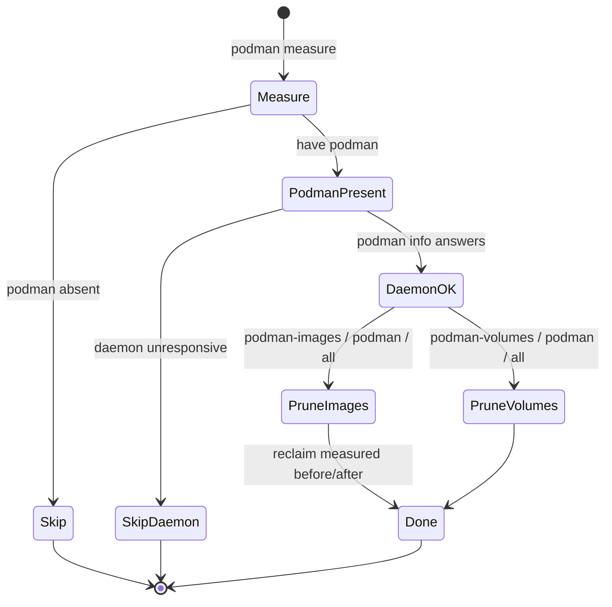

# Native Podman stage in disk-cleanup — Design

**Status:** Proposed

## Decision

`disk-cleanup.sh` gains **native Podman stages** that invoke `podman` directly.
They are exact mirror-images of the existing Docker stages (1 and 4), so the tool
reclaims container storage whether the host uses Docker or Podman, without a
`docker` CLI shim.

## Statechart (blueprint)



## Stage behavior

| Stage | Command | Risk | What "clean" means |
| --- | --- | --- | --- |
| `podman-images` | `podman image prune -a -f` | none (re-pull) | 0 images / 0 reclaimed |
| `podman-volumes` | `podman volume prune -f` | reconstructible | 0 volumes / 0 reclaimed |

Both stages measure free bytes on the storage filesystem before and after and
report the delta (never a tool-forecast). This keeps the script's founding rule:
*"reclaim is only ever reported after the fact."*

## `measure` addition

When `podman` is present, `measure` prints:

```
Podman root:  ~/.local/share/containers/storage (filesystem /, N available)
Podman images:  N
Podman volumes: N
```

`podman system df` provides sizes; image/volume counts come from native
`podman images -q` / `podman volume ls -q`.

## `require_podman()` contract

Mirrors `require_docker()`:

- `have podman` false → log `SKIP: podman is not installed — nothing to do for this stage.` → return 1.
- `podman info` fails → log `SKIP: podman is installed but the daemon did not answer (see the error above).` → return 1.
- Absence or daemon failure is **`SKIP`**, never `already clean`. A stage that
  did not run and one that had nothing to do are different outcomes.

## Wiring

- New subcommands: `podman-images`, `podman-volumes`, `podman` (both).
- `all` sequence: measure → docker-images → **podman-images** → node-modules →
  worktrees → docker-volumes → **podman-volumes** → build-artifacts, stopping at
  `--target`.

## Stderr / hooks

- `podman` stderr is funneled into the single shared combined log (stdout plus
  stderr into one file); never discarded, never folded silently.
- The exit status of `podman` is preserved and reported.

## Rejected

- Detecting podman via `docker info` (the gap this change closes).
- Silent stderr suppression of the `podman` commands (`/dev/null` style).
- Treating "podman absent" as "clean".
- A separate `podman` binary wrapper outside `disk-cleanup.sh`.
