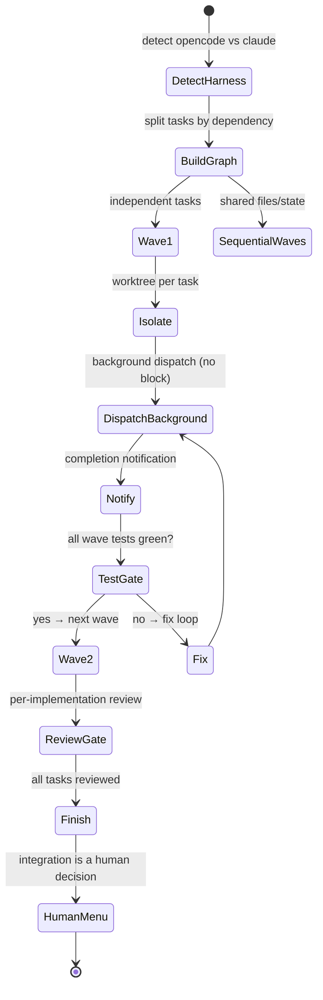

# /parallel-subagents — Design

**Status:** Proposed

## Decision

A harness-agnostic orchestrator skill that dispatches **independent tasks in
parallel with background execution**, isolating each in its own worktree, gating
waves on tests, reviewing each implementation, and leaving integration to a
human. It routes to the correct per-harness subagent skill.

## Statechart (blueprint)



## Harness detection

```
if [ -n "$OPENCODE_..." ] || [ -d "$HOME/.config/opencode" ]; then harness=opencode
elif [ -d "$HOME/.claude" ] || command -v claude; then harness=claude
else harness=opencode   # default; override via $ARGUMENTS
```

OpenCode → `subagents-opencode` (herdr). Claude → `subagents-claude`
(`.claude/agents`, `ListAgents`/`SendMessage`, `--worktree`).

## Dependency graph

- Build the graph from the task list. Tasks touching **different files** and
  **no shared state** → run in the same parallel wave.
- Tasks sharing files/state → sequenced into waves, with a commit gate between
  waves so the next wave reads the latest state.
- Prefer **new files** over shared edits where possible.

## Isolation

- One worktree per task: `git worktree add .agents/worktrees/<slug> -b <branch> <base>`.
- Block broad staging (`git add -A` / `git add .`) via hook.
- Commit the baseline before dispatch; commit between handoffs.

## Background dispatch

- Dispatches use **background execution** (`background: true` — the coordinator
  does not block waiting). The task runs in an isolated context (herdr for
  OpenCode; a separate `.claude/agents` worker for Claude).
- Completion is delivered via **notification** (not blocking the coordinator).
- Prompts are self-contained: scope, file refs, constraints, success criteria,
  expected output.

## Wave gate

Between waves, run the test suite. Do not start the next wave until the current
one is green where## Review gate

After each implementation, dispatch a **reviewer** (spec + diff). If gaps are
found, dispatch a **fresh fix agent** (completed agents cannot receive follow-up
messages) with the gap report. Mark the task complete only after review passes.

## Finishing

When all tasks are verified, present a **human integration** decision. The
HITL criteria is surfaced via **`/resolve-open-questions`** (the skill that
sweeps open decisions and resolves them through structured ask batches with
options + a recommendation) — a menu of merge locally / push + PR / keep as-is.
**Never auto-merge.** The integration decision belongs to the human.

## Rejected

- Parallel dispatch of tasks that share files/state.
- Treating background as "fire and forget with no review".
- Auto-merging on completion.
- Agent Teams orchestration in this change (deferred).
- A single monolithic skill that ignores harness differences.
