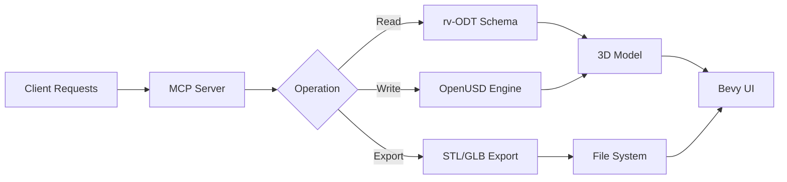

# Design — 3D Graphics CAD Toolkit

## System Overview

The 3D Graphics CAD Toolkit is a **Rust-based desktop application** that provides comprehensive 3D modeling, visualization, and industrial automation capabilities. Built on the Bevy Engine with Iced RS UI, it serves as a digital twin platform for industrial automation workflows.

### Architecture Pattern

**Vitemcp Stateless Design**


### Core Components

#### 1. Backend MCP Server (`src/server.rs`)
- **Stateless**: vitemcp pattern with explicit task tracking
- **Schema Validation**: rv-ODT schema validation and processing
- **Tool Integration**: Native Rust tools with MCP protocol
- **OpenUSD Integration**: NVIDIA Omniverse connectivity
- **Command Processing**: 3D model operations and industrial workflows

#### 2. Frontend (`src/ui/`)
- **Bevy Engine**: 3D rendering and real-time visualization
- **Iced RS**: Cross-platform UI framework
- **Workspace**: Shared digital twin environment
- **Collaboration**: Multi-user workspace support

#### 3. Model Operations (`src/operations/`)
- **Import**: STL, GLB, USD file handling
- **Export**: Parametric modeling with STL/GLB/USD output
- **Transformation**: Open polygen 3D-to-CAD bridge
- **Manipulation**: Parametric modifiers and constraints
- **Visualization**: Real-time 3D preview and rendering

#### 4. Industrial Automation (`src/automation/`)
- **rv-ODT Integration**: Configuration-driven workflows
- **Process Simulation**: Manufacturing process modeling
- **Performance Monitoring**: Real-time metrics and analytics
- **Control**: Automated workflow execution

### Data Flow

```
rv-ODT Schema → MCP Server → OpenUSD Engine → Bevy UI → User Input
    ↓                                       ↓
 STL/GLB/ USD Import ↔ Export ↔ Transformation ↔ Collaboration
```

### rv-ODT Schema Integration

**Schema Structure**
```json
{
  "digital_twin": {
    "factory_layout": {
      "dimensions": {...},
      "components": [...]
    },
    "processes": {
      "production_line": {
        "steps": [...],
        "parameters": {...}
      }
    },
    "automation": {
      "workflows": [...],
      "triggers": [...]
    }
  }
}
```

**Schema Processing**
1. **Validation**: rv-ODT schema validation on load
2. **Transformation**: Convert to internal representation
3. **Application**: Apply to 3D models and workflows
4. **Update**: Sync changes back to schema when modified

### OpenUSD Integration

**3D Operations**
- **Scene Graph**: Hierarchical 3D object representation
- **Materials**: Physically-based rendering materials
- **Physics**: Simulation capabilities for industrial processes
- **Variants**: Multiple configuration states
- **Time**: Animation and timeline support

**NVIDIA Omniverse Connectivity**
```rust
// Example: Loading a USD scene
let scene = omniverse_client
    .load_stage("/World/Factory")
    .await?;

// Apply rv-ODT configuration
let config = rv_odt_schema
    .get_section("factory_layout");

scene.apply_configuration(config);
```

### UI Architecture

**Bevy Integration**
```rust
fn setup_ui(mut commands: Commands) {
    // 3D camera setup
    commands.spawn(Camera3dBundle {
        transform: Transform::from_translation(Vec3::new(0.0, 10.0, 20.0)),
        ..default()
    });
    
    // Lighting setup
    commands.spawn(PointLightBundle {
        point_light: PointLight {
            intensity: 1000.0,
            ..default()
        },
        transform: Transform::from_translation(Vec3::new(0.0, 5.0, 0.0)),
        ..default()
    });
}
```

**Iced RS UI**
```rust
fn build_ui(cx: &mut ReduxContext) {
    // Digital twin explorer
    cx.render(ExplorerPanel::new("Digital Twins"));
    
    // Process workflow editor
    cx.render(WorkflowEditor::new("Automation"));
    
    // 3D model properties
    cx.render(ModelProperties::new("Properties"));
}
```

### Error Handling

**Structured Error Types**
```rust
enum AppError {
    SchemaValidationError(String),
    OpenUsdError(String),
    ModelOperationError(String),
    AutomationError(String),
    UiError(String),
}
```

**Error Recovery**
- **Graceful Degradation**: Continue with limited functionality on error
- **Automatic Retry**: Retry failed operations with exponential backoff
- **User Feedback**: Clear error messages with recovery options
- **Logging**: Detailed error logging for debugging

### Performance Considerations

**Optimization Strategy**
1. **Asset Management**: Efficient 3D model loading and caching
2. **Threading**: Background processing for heavy operations
3. **Memory Management**: Efficient allocation and deallocation
4. **Rendering Optimization**: Instanced rendering, occlusion culling

**Performance Metrics**
- **3D Model Loading**: < 500ms for standard models
- **Export Operations**: < 1s for STL/GLB export
- **Real-time Interaction**: 60 FPS minimum
- **Startup Time**: < 3 seconds

### Security Considerations

**Access Control**
- **File Permissions**: Secure file system access
- **Network Security**: Encrypted communications for remote tools
- **Data Validation**: Input validation and sanitization
- **Access Logs**: Comprehensive audit trails

**Data Protection**
- **Schema Encryption**: rv-ODT schema encryption for sensitive data
- **Backup**: Automatic backup of configurations and models
- **Recovery**: Versioned backup with rollback capability

### Deployment Strategy

**Cross-Platform Build**
```toml
[package]
name = "3d-graphics-cad-toolkit"
version = "0.1.0"
edition = "stable"

[target.x86_64-apple-darwin]
rustflags = ["-C", "link-arg=-undefined"]

[target.x86_64-unknown-linux-gnu]
rustflags = ["-C", "link-arg=--export-dynamic"]

[target.x86_64-pc-windows-msvc]
rustflags = ["-C", "link-arg=/CONSOLE"]
```

**Installation**
1. **Binary Distribution**: Cross-platform binaries
2. **Package Managers**: Support for npm, cargo, system package managers
3. **Docker**: Containerized deployment option
4. **Development**: Local development with hot reload

### Development Workflow

**Git Workflow**
```bash
# Development branch
feat/142-3d-graphics-cad-toolkit

# Feature branches
feature/:
    feature/odt-integration
    feature/openusd-connector
    feature/bevy-ui
    feature/automation-workflows

# Release branches
release/
    release/0.1.0-beta
    release/0.1.0-stable
```

**Testing Strategy**
1. **Unit Tests**: Component-level testing
2. **Integration Tests**: System integration testing
3. **E2E Tests**: User workflow testing
4. **Performance Tests**: Load and stress testing
5. **Regression Tests**: Automated regression testing

**CI/CD Pipeline**
1. **Code Quality**: Linting, formatting, type checking
2. **Build**: Cross-platform binary compilation
3. **Testing**: Full test suite execution
4. **Release**: Automated release generation
5. **Deployment**: Staging to production

### Extensibility

**Plugin Architecture**
```rust
pub trait ToolPlugin {
    fn name(&self) -> &'static str;
    fn version(&self) -> &'static str;
    fn execute(&self, params: ToolParams) -> Result<ToolResult, ToolError>;
}
```

**Configuration**
- **Plugin Management**: Dynamic plugin loading
- **Tool Registration**: Runtime tool discovery
- **Configuration**: Plugin-specific settings
- **Lifecycle**: Plugin initialization and cleanup

### Future Roadmap

**Phase 1: Core Features (v0.1.0)**
- ✅ rv-ODT schema integration
- ✅ Basic 3D model operations
- ✅ OpenUSD connectivity
- ✅ Bevy UI foundation
- ✅ Basic automation workflows

**Phase 2: Advanced Features (v0.2.0)**
- Advanced OpenUSD scene manipulation
- Collaborative workspace features
- Cloud synchronization
- Advanced automation workflows
- Integration with industrial tools

**Phase 3: Enterprise Features (v0.3.0)**
- Multi-user collaboration
- Advanced security features
- Performance optimization
- Custom plugin marketplace
- Industry-specific workflows

### Technology Stack

**Core**
- **Rust**: Language and runtime
- **Bevy**: 3D rendering engine
- **Iced RS**: UI framework
- **OpenUSD**: 3D model operations
- **rv-ODT**: Configuration schema

**Supporting**
- **GitHub Actions**: CI/CD pipeline
- **Cargo**: Package manager
- **Docker**: Containerization
- **WebAssembly**: Browser-based deployment
- **gRPC**: Inter-process communication

**Developer Tools**
- **cargo-watch**: Development watch
- **cargo-expand**: Macro expansion
- **cargo-afl**: Fuzz testing
- **cargo-cov**: Code coverage
- **cargo-ldproxy**: Linker proxy

This design document provides a comprehensive blueprint for the 3D Graphics CAD Toolkit, balancing technical depth with practical implementation guidance. It serves as both a technical specification and a development roadmap for the application.