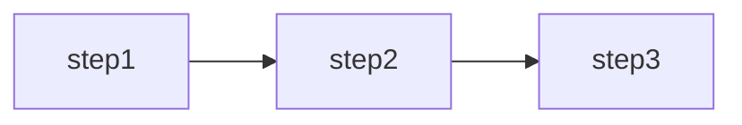
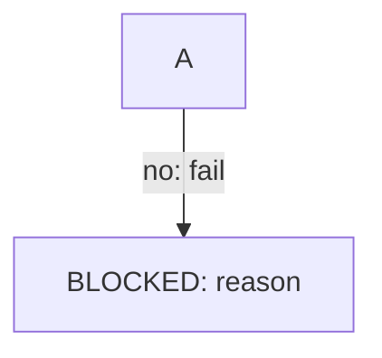
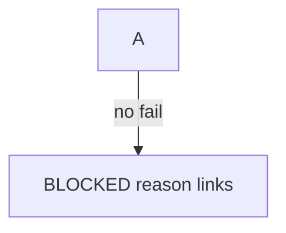

# convention: mermaid-github
id: mermaid-github · version: 0.1.0 · status: draft · level: platform
extracted_at: 2026-10-13 · ttl_expires: 2027-01-11
parent: markdown-docs

## GOAL

Diagramas Mermaid en Markdown que **renderizan en la vista de archivo y PR de
github.com** sin “Unable to render rich display”.

## SOURCES

| # | kind | ref | weight | para qué |
|---|------|-----|--------|----------|
| S1 | docs | mermaid.js.org — flowchart syntax | load-bearing | nodos y aristas |
| S2 | docs | mermaid.js.org — sequenceDiagram | load-bearing | alt/opt |
| S3 | docs | GitHub blog / community — Mermaid in Markdown (renderer subset) | context | límites prácticos |

## RULES

- D0 [flowchart-direction] Procesos secuenciales (gates, triage, pipelines) usan
  **`flowchart TD`** (top-down, vertical) por defecto; `LR` solo con justificación
  breve en el PR (p. ej. arquitectura ancha con pocos pasos) → S1.
- D1 [flowchart-edges] Etiquetas de arista **sin** `:` literal (`|no BLOCKED|` no `|no: BLOCKED|`) → S1 + incidente assurance.
- D2 [flowchart-nodes] Texto con `/`, `§`, acentos o comandos con `:` → nodo entre comillas dobles → S1.
- D3 [flowchart-ids] IDs de nodo ASCII (`VT`, `Hub`); etiqueta legible en corchetes → S1.
- D4 [sequence-participants] Alias de participant sin `/` ni `§` en el alias (`assurance-triage-pr` OK) → S2.
- D5 [sequence-control] No anidar `opt` dentro de `alt` sin cerrar `opt`; preferir secuencia lineal + `alt`/`else` → S2.
- D6 [profile] Validar en GitHub preview antes de marcar PR listo; dogfood en `_exemplars/docs-diagrams/` → S3.

## COUNTEREXAMPLES

(❌ wrong for a vertical gate pipeline — use `flowchart TD` per D0 unless the PR
documents why horizontal layout is clearer.)

## GATES

- local: checklist en `_exemplars/docs-diagrams/README.md` (abrir preview en PR).
- CI: (opcional) `mmdc -i _exemplars/docs-diagrams/*.mmd -o /tmp/out.svg` cuando Chromium disponible.

## LESSONS

- L1 (assurance `protocol.md` render failure) Perfil `mermaid-github` creado; hub LESSONS referencia este record.

## RECEIPT

Ver `_exemplars/docs-diagrams/` tras pegar bloques en un PR de prueba.
