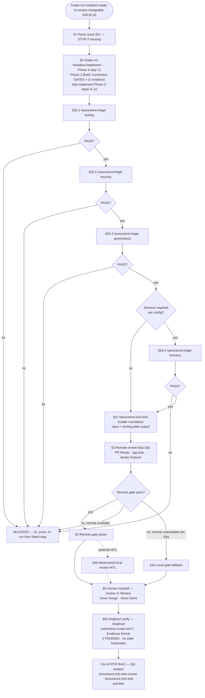

# Engineering standards — SSOT & pipeline

> SSOT at monorepo level: `shared/references/engineering-standards/`.
> Are you an agent? Reference these standards by monorepo-relative path
> (`shared/references/engineering-standards/<file>`) — never copy their text.
> The canonical index of the 32 practices lives in [`index.md`](index.md).

Portable baseline for any client startup. **Not a greenfield framework** — names and
enforces conventions already in industry use.

## Pipeline (end-to-end)

The full change pipeline — from tracker issue to human review handoff — is
orchestrated by `/ready-to-review-mergeable` (protocol:
`toolkits/make-no-mistakes-toolkit/references/ready-to-review-mergeable/protocol.md`).
**Invariant: never merge.** The merge itself happens after the handoff, executed
by a human, and is governed by MPH/NSQ/REL.

| Stage (in RTR) | Standard |
| --- | --- |
| Tracker issue → change folder | **OST** |
| PR description + scope | **PRDS** |
| QA traceability (req → test) | **QT4L** |
| CI/security gates | **CIS** |
| Remote review gate | CI checks (green) |
| Exit = human handoff; never merge | RTR protocol (invariant) |
| **After** handoff — merge (human) | **MPH** · **NSQ** · **REL** · **GGT** |

The **32 practices** (scope, SSOT, adoption order) are listed in [`index.md`](index.md).

## Adoption policy

- **Incremental only** — apply when adding or materially editing code in that area. No mass legacy refactors for compliance.
- **Satellite repos** — client `AGENTS.md` links here. Do not duplicate full text in apps/packages.
- **Not a refactor license** — standards adoption does not authorize out-of-scope folder moves or barrel rewrites.

## Commands

| Command | Purpose |
| --- | --- |
| `/engineering-standards-setup` | Scaffold pointers + PR template + QT4L stub in a client repo (index of 32) |
| `/engineering-standards-audit` | Measure adoption (all 32, parallelizable per family). Audit open PRs when `--prs`. |

Protocol SSOT: `references/engineering-standards-setup/protocol.md`, `references/engineering-standards-audit/protocol.md`.

## Quick reference

| Question | Practice |
| --- | --- |
| Feature folder or `shared/`? | DSMS |
| Domain boundaries and ubiquitous language? | DDD |
| imports → types → main → helpers? | IFS |
| Banner on sections? | IFS (file) / CPS (barrel) |
| Public barrel export? | CPS |
| Comment intent, not "how"? | CCC |
| Conventional commit format? | CvC |
| Group commits semantically? | CLG |
| PR description and size? | PRDS |
| Pre-commit enforcement? | PCH |
| Branch naming and protection? | BrS |
| Worktree hygiene / parity? | WTD |
| Stop on anomaly? | Jidoka |
| stderr/stream discipline? | StS |
| Scenario → verification in tasks? | QT4L |
| One OpenSpec folder per store PR? | OST |
| Prevent drift across repos? | RDP |
| Hardcoded sha256 in a setup script? | CHH |
| How do I bump a plugin version? | SemVer (monotonic vs main, merge queue) |
| How do I protect `main` even from founders? | MPH (ruleset + 2FA + pre-tool-use fail-closed guard) |
| Which `.gitignore` patterns must I vendor? | BGI (catalog `vendored-gitignore.toml`) |
| Is it a playbook or a runbook? | ODT (taxonomy. Never mix) |
| How do I integrate features and releases? | GGT (feature→develop rebase. develop→main merge commit) |
| How do I cut a release (PROD)? | REL (one develop→main PR. CTO QA audit. second human reviewer = sole gate) |
| How do I gate release risk post-cut? | FFF (flags: kill switch, rollout, entitlement) |
| Where do I search for the truth? | LTGT (git common-dir + all worktrees + hidden paths. Never CWD-only) |
| How do I verify the order formally? | TFM (TLA+/TLC recipe) |

## Provenance

Generalized from production SaaS platform process docs (multi-repo OpenSpec,
agent handoffs, and store PR traceability): `code-organization-standards`,
`pull-request-description-and-scope`, `branching-strategy`,
`qa-traceability-four-layers`. Client-specific assignees, tracker IDs, product
names, and repo URLs belong in the client repo's `AGENTS.md`, not in this SSOT.
