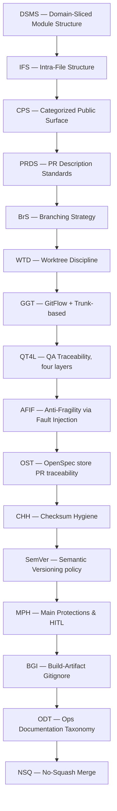

# Engineering standards — index (17 practices + OST)

> SSOT at monorepo level: `shared/references/engineering-standards/`.
> Do not duplicate these files inside toolkits — reference them by monorepo-relative
> path `shared/references/engineering-standards/<file>`.

Portable baseline for any client startup. **Not a greenfield framework** — names and
enforces conventions already in industry use.

| Sigla | Name | Scope | SSOT |
| --- | --- | --- | --- |
| **1. DSMS** | Domain-Sliced Module Structure | Where files live | [dsms-ifs-cps.md](dsms-ifs-cps.md) §1 |
| **2. IFS** | Intra-File Structure | How one file reads top-to-bottom | [dsms-ifs-cps.md](dsms-ifs-cps.md) §2 |
| **3. CPS** | Categorized Public Surface | How public barrels export | [dsms-ifs-cps.md](dsms-ifs-cps.md) §3 |
| **4. PRDS** | Pull Request Description Standards | PR body + reviewable size | [prds.md](prds.md) |
| **5. BrS** | Branching Strategy | Branches, naming, protection | [branching-strategy.md](branching-strategy.md) |
| **6. WTD** | Worktree Discipline | Worktrees are transient and never committed. Parity (1 issue = 1 worktree = 1 PR) is an association policy, not persistence. | [worktree-discipline.md](worktree-discipline.md) |
| **7. GGT** | GitFlow + Trunk-based | Hybrid model: feature→`develop` rebase. `develop`→`main` merge commit. Auditable setup + repo-initial-setup step | [gitflow-trunk.md](gitflow-trunk.md) |
| **8. QT4L** | QA Traceability (four layers) | Req → automated test → manual QA → HITL | [qa-traceability-four-layers.md](qa-traceability-four-layers.md) |
| **9. AFIF** | Anti-Fragility via Fault Injection | Harden every layer by injecting faults (mutation, formal self-test, chaos, gate negatives). "Never seen fail" is not a pass. | [anti-fragility-fault-injection.md](anti-fragility-fault-injection.md) |
| **10. OST** | OpenSpec store PR traceability | Tracker → change folder → one store PR → one merge | [openspec-store-pr-traceability.md](openspec-store-pr-traceability.md) |
| **11. CHH** | Checksum Hygiene | Setup scripts pin the VERSION and verify release assets against the release's own checksum manifest — never hardcoded sha256 constants | [checksum-hygiene.md](checksum-hygiene.md) |
| **12. SemVer** | Semantic Versioning policy | Version source = plugin.json. The generator derives marketplace.json from it. The merge queue enforces a monotonic bump vs the default branch (rebase + re-bump). | [semver.md](semver.md) |
| **13. MPH** | Main Protections & HITL Merge Guard | Default branch ruleset (only named team bypass) + org-wide 2FA + pre-tool-use guard that requires interactive human approval for any bypass/admin merge. Fail-closed. | [main-protections-hitl.md](main-protections-hitl.md) |
| **14. BGI** | Build-Artifact Gitignore | Every repo vendors the ignore patterns from `vendored-gitignore.toml` (venv, node_modules, target, build, caches). Promotes the symlink build-artifact policy | [build-artifacts-gitignore.md](build-artifacts-gitignore.md) |
| **15. ODT** | Ops Documentation Taxonomy | Classify every ops doc as Playbook vs Runbook vs SOP. Never mix. Route via /document-this | [ops-documentation-taxonomy.md](ops-documentation-taxonomy.md) |
| **16. NSQ** |
| **17. TFM** | Formal Model TLA+ | Standardized TLA+/TLC modeling and validation recipe | [formal-model-tla.md](formal-model-tla.md) | No-Squash Merge | Every repo sets `allow_squash_merge: false`. Merge and rebase stay allowed. Rulesets exclude squash. The local guard blocks `--squash`. | [no-squash-merge.md](no-squash-merge.md) |

The **clean code quartet** is DSMS + IFS + CPS + PRDS. BrS + WTD govern branching
and worktree hygiene. QT4L and **OST** (when the client uses an OpenSpec store)
complete QA traceability and spec promotion discipline.

**Adoption order** (flowchart TD):

**Day-to-day priority:** IFS, PRDS, and QT4L (reading rhythm, review rhythm, req→test trace).

## Adoption policy

- **Incremental only** — apply when adding or materially editing code in that area. No mass legacy refactors for compliance.
- **Satellite repos** — client `AGENTS.md` links here. Do not duplicate full text in apps/packages.
- **Not a refactor license** — standards adoption does not authorize out-of-scope folder moves or barrel rewrites.

## Commands

| Command | Purpose |
| --- | --- |
| `/clean-code-standards-setup` | Scaffold pointers + PR template + QT4L stub in a client repo |
| `/clean-code-standards-audit` | Measure adoption. Audit open PRs when `--prs`. |

Protocol SSOT: `references/clean-code-standards-setup/protocol.md`, `references/clean-code-standards-audit/protocol.md`.

## Quick reference

| Question | Practice |
| --- | --- |
| Feature folder or `shared/`? | DSMS |
| imports → types → main → helpers? | IFS |
| Banner on sections? | IFS (file) / CPS (barrel) |
| Public barrel export? | CPS |
| PR description and size? | PRDS |
| Branch naming and protection? | BrS |
| Worktree hygiene / parity? | WTD |
| Scenario → verification in tasks? | QT4L |
| One OpenSpec folder per store PR? | OST |
| Hardcoded sha256 in a setup script? | CHH |
| How do I bump a plugin version? | SemVer (monotonic vs main, merge queue) |
| How do I protect `main` even from founders? | MPH (ruleset + 2FA + pre-tool-use fail-closed guard) |
| Which `.gitignore` patterns must I vendor? | BGI (catalog `vendored-gitignore.toml`) |
| Is it a playbook or a runbook? | ODT (taxonomy. Never mix) |
| How do I integrate features and releases? | GGT (feature→develop rebase. develop→main merge commit) |
| How do I verify the order formally? | TFM (TLA+/TLC recipe) |

## Provenance

Generalized from production SaaS platform process docs (multi-repo OpenSpec,
agent handoffs, and store PR traceability): `code-organization-standards`,
`pull-request-description-and-scope`, `branching-strategy`,
`qa-traceability-four-layers`. Client-specific assignees, tracker IDs, product
names, and repo URLs belong in the client repo's `AGENTS.md`, not in this SSOT.
