# Engineering standards — index (36 practices) — SSOT

> SSOT at monorepo level: `shared/references/engineering-standards/index.md`.
> Are you an agent? Reference these standards by monorepo-relative path
> (`shared/references/engineering-standards/<file>`) — never copy their text.
> The end-to-end pipeline that orchestrates these practices lives in
> [`README.md`](README.md) (entry point).

| Sigla | Name | Scope | SSOT |
| --- | --- | --- | --- |
| **1. DSMS** | Domain-Sliced Module Structure | Where files live | [dsms-ifs-cps.md](dsms-ifs-cps.md) §1 |
| **2. DDD** | Domain-Driven Design | Bounded contexts, ubiquitous language, aggregates; design guided by the domain | [domain-driven-design.md](domain-driven-design.md) |
| **3. IFS** | Intra-File Structure | How one file reads top-to-bottom | [dsms-ifs-cps.md](dsms-ifs-cps.md) §2 |
| **4. CPS** | Categorized Public Surface | How public barrels export | [dsms-ifs-cps.md](dsms-ifs-cps.md) §3 |
| **5. CCC** | Code Comment Convention | Meaningful non-obvious comments; no redundant "how" comments | [code-comment-convention.md](code-comment-convention.md) |
| **6. CLH** | Copyright/License Header | Headers per repo LICENSE.md; not a global rule | [copyright-license-header.md](copyright-license-header.md) |
| **7. CvC** | Conventional Commits | Commit message format `type(scope): description`; machine-readable history and changelog generation | [conventional-commits.md](conventional-commits.md) |
| **8. CLG** | Commit Logic Groups | Commit intermediate work in semantic groups; each commit is self-contained and reviewable | [commit-logic-groups.md](commit-logic-groups.md) |
| **9. PCH** | Pre-Commit Hooks | Vendored canonical pre-commit config + shared Mermaid validator; hooks enforced repo-wide | [pre-commit-hooks.md](pre-commit-hooks.md) |
| **10. PRDS** | Pull Request Description Standards | PR body + reviewable size | [prds.md](prds.md) |
| **11. BrS** | Branching Strategy | Branches, naming, protection | [branching-strategy.md](branching-strategy.md) |
| **12. WTD** | Worktree Discipline | Worktrees are transient and never committed. Parity (1 issue = 1 worktree = 1 PR) is an association policy, not persistence. | [worktree-discipline.md](worktree-discipline.md) |
| **13. Jidoka** | Stop-on-Anomaly | Stop on any anomaly; record the owning boundary and a root-cause hypothesis before continuing. Never "see if the rest works" after a failure. | [jidoka.md](jidoka.md) |
| **14. StS** | Stderr/Stream Standards | Never send a stream to null; fold stderr into the same sink (`> out.log 2>&1` or `2>&1 \| tee run.log`); separate-file redirects are forbidden. | [stderr-stream-standards.md](stderr-stream-standards.md) |
| **15. GGT** | GitFlow + Trunk-based | Hybrid model: feature→`develop` rebase. `develop`→`main` merge commit. Auditable setup + repo-initial-setup step | [gitflow-trunk.md](gitflow-trunk.md) |
| **16. QT4L** | QA Traceability (four layers) | Req → automated test → manual QA → HITL | [qa-traceability-four-layers.md](qa-traceability-four-layers.md) |
| **17. AFIF** | Anti-Fragility via Fault Injection | Harden every layer by injecting faults (mutation, formal self-test, chaos, gate negatives). "Never seen fail" is not a pass. | [anti-fragility-fault-injection.md](anti-fragility-fault-injection.md) |
| **18. OST** | OpenSpec store PR traceability | Tracker → change folder → one store PR → one merge | [openspec-store-pr-traceability.md](openspec-store-pr-traceability.md) |
| **19. RDP** | Repository Drift Prevention | Single source of truth per artifact; detect and prevent drift across repos/config | [repository-drift-prevention.md](repository-drift-prevention.md) |
| **20. CHH** | Checksum Hygiene | Setup scripts pin the VERSION and verify release assets against the release's own checksum manifest — never hardcoded sha256 constants | [checksum-hygiene.md](checksum-hygiene.md) |
| **21. SemVer** | Semantic Versioning policy | Version source = plugin.json. The generator derives marketplace.json from it. The merge queue enforces a monotonic bump vs the default branch (rebase + re-bump). | [semver.md](semver.md) |
| **22. MPH** | Main Protections & HITL Merge Guard | Default branch ruleset (only named team bypass) + org-wide 2FA + pre-tool-use guard that requires interactive human approval for any bypass/admin merge. Fail-closed. | [main-protections-hitl.md](main-protections-hitl.md) |
| **23. BGI** | Build-Artifact Gitignore | Every repo vendors the ignore patterns from `vendored-gitignore.toml` (venv, node_modules, target, build, caches). Promotes the symlink build-artifact policy | [build-artifacts-gitignore.md](build-artifacts-gitignore.md) |
| **24. ODT** | Ops Documentation Taxonomy | Classify every ops doc as Playbook vs Runbook vs SOP. Never mix. Route via /document-this | [ops-documentation-taxonomy.md](ops-documentation-taxonomy.md) |
| **25. NSQ** | No-Squash Merge | Every repo sets `allow_squash_merge: false`. Merge and rebase stay allowed. Rulesets exclude squash. The local guard blocks `--squash`. | [no-squash-merge.md](no-squash-merge.md) |
| **26. TFM** | Formal Model TLA+ | Standardized TLA+/TLC modeling and validation recipe | [formal-model-tla.md](formal-model-tla.md) |
| **27. CIS** | CI Security & Standards | Standardized CI security gates (CodeQL/Trivy/SAST), vendorized templates, traceable evidence | [ci-security-standards.md](ci-security-standards.md) |
| **28. REL** | Release Cut | One consolidated `develop`→`main` PR. CTO owns the QA audit (QT4L). A second human reviewer is the sole PROD gate. Hotfixes only via `hotfix/*`. | [release-cut.md](release-cut.md) |
| **29. FFF** | Feature Flag Families | Two-level model: families (Release, Experimentation, Ops, Access, Decommissioning, Security vendorization) each with an internal taxonomy of subtypes. Interfaces with REL/MPH/GGT/DDD. | [feature-flag-families.md](feature-flag-families.md) |
| **30. LTGT** | Local Truth is not Ground Truth | A CWD shows one worktree's branch. Ground truth is the repo: `git rev-parse --git-common-dir`, `git worktree list`, `git ls-files`, with hidden paths included. Never conclude absence from a CWD-only scan. | [local-vs-ground-truth.md](local-vs-ground-truth.md) |
| **31. no-deprecated-agent-shims** | No deprecated agent shims | Renames are clean-cut: update references and delete the old path; no "MOVED (shim)" or exec wrappers. | [no-deprecated-agent-shims.md](no-deprecated-agent-shims.md) |
| **32. codeowners-replication** | CODEOWNERS replication | Org admin App workflow replicates CODEOWNERS; single source, no drift. | [codeowners-replication-workflow.md](codeowners-replication-workflow.md) |
| **33. BIB** | Bilingual Issue Brief | Every issue (GitHub o Linear) redactado en formato Bilingual ANTES de abrirlo — Human Layer + Agent Layer (HUMAN LAYER / AGENT LAYER / Acceptance Criteria / Context Files). Gate determinístico `shared/hooks/bilingual/detect.py`. | [bilingual-issue-brief.md](bilingual-issue-brief.md) |
| **34. TAS** | Test Assertion Standards | Aserciones de contrato e invariantes, no snapshots: nunca conteos literales de registros que crecen; derivar del source of truth (p.ej. `NPM_PACKAGES.length`). | [test-assertion-standards.md](test-assertion-standards.md) |
| **35. DPC** | Dependency Caching | Universal pattern (lockfile + frozen install + cached store). Canonical manager per language (pnpm for Node/JS). CI caches store by lockfile hash; local uses per-user store. | [dependency-caching.md](dependency-caching.md) |
| **36. CFM** | Customer-Facing Management Docs | SPMP / 16085 risk plans and similar signed management docs: descriptive executive voice for the customer representative — not STE procedure imperatives for agents. Complements ODT. | [customer-facing-management-docs.md](customer-facing-management-docs.md) |

The **clean code quartet** is DSMS + IFS + CPS + PRDS. BrS + WTD govern branching
and worktree hygiene. QT4L and **OST** (when the client uses an OpenSpec store)
complete QA traceability and spec promotion discipline.

**Adoption order** (flowchart TD):

```mermaid
flowchart TD
    S0[DSMS — Domain-Sliced Module Structure]
    S1[DDD — Domain-Driven Design]
    S2[IFS — Intra-File Structure]
    S3[CPS — Categorized Public Surface]
    S4[CCC — Code Comment Convention]
    S5[CLH — Copyright/License Header]
    S6[CvC — Conventional Commits]
    S7[CLG — Commit Logic Groups]
    S8[PCH — Pre-Commit Hooks]
    S9[PRDS — PR Description Standards]
    S10[BrS — Branching Strategy]
    S11[WTD — Worktree Discipline]
    S12[Jidoka — Stop-on-Anomaly]
    S13[StS — Stderr/Stream Standards]
    S14[GGT — GitFlow + Trunk-based]
    S15[QT4L — QA Traceability, four layers]
    S16[AFIF — Anti-Fragility via Fault Injection]
    S17[OST — OpenSpec store PR traceability]
    S18[RDP — Repository Drift Prevention]
    S19[CHH — Checksum Hygiene]
    S20[SemVer — Semantic Versioning policy]
    S21[MPH — Main Protections & HITL]
    S22[BGI — Build-Artifact Gitignore]
    S23[ODT — Ops Documentation Taxonomy]
    S24[NSQ — No-Squash Merge]
    S25[TFM — Formal Model TLA+]
    S26[CIS — CI Security & Standards]
    S27[REL — Release Cut]
    S28[FFF — Feature Flag Families]
    S29[LTGT — Local Truth is not Ground Truth]
    S30[no-deprecated-agent-shims]
    S31[codeowners-replication]
    S32[BIB — Bilingual Issue Brief]
    S33[TAS — Test Assertion Standards]
    S34[DPC — Dependency Caching]
    S0 --> S1 --> S2 --> S3 --> S4 --> S5 --> S6 --> S7 --> S8 --> S9
    S9 --> S10 --> S11 --> S12 --> S13 --> S14 --> S15
    S15 --> S16 --> S17 --> S18 --> S19 --> S20 --> S21 --> S22
    S22 --> S23 --> S24 --> S25 --> S26 --> S27 --> S28 --> S29
    S29 --> S30 --> S31 --> S32 --> S33 --> S34
```

**Day-to-day priority:** IFS, PRDS, QT4L (reading rhythm, review rhythm, req→test trace), Jidoka, StS.
