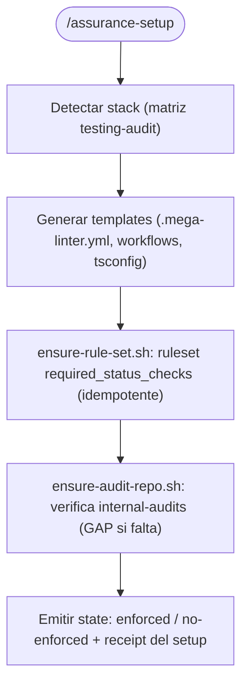

# /assurance-repo-setup — protocol SSOT

Genera el gate de calidad de `/assurance` (MegaLinter + typecheck + ruleset +
`internal-audits`) en el **lado repo**: archivos commiteados y configuración
remota. Es **idempotente**. El lado **local** (máquina del dev, hooks, deps)
vive en `/assurance-local-setup` — este protocolo no lo toca.

## Qué genera

| Artefacto | Descripción |
|-----------|-------------|
| `.mega-linter.yml` | Linters según el stack detectado + `PRE_COMMANDS` de typecheck |
| `.github/workflows/megalinter.yml` | Gate CI (corre **siempre**: sin filtros `paths`) + artifacts SARIF/JSON |
| `.github/workflows/bypass-audit.yml` | Detección de bypass y persistencia de receipt en `internal-audits` |
| `shared/hooks/tsconfig.json` (si hay TS) | Base ESM para `tsc --noEmit` (typecheck) |
| Ruleset `required_status_checks` | Asegurado por `ensure-rule-set.sh` (si hay permisos) |

## Lecciones incorporadas (no improvisar)

Las siguientes reglas **son** el protocolo; vienen de errores observados:

1. **El check corre siempre.** El workflow `megalinter` **no** lleva `on.<event>.paths`.
   Un check requerido que a veces no corre queda "inexistente" y bloquea el merge
   (falso positivo permanente).
2. **El typecheck no es nativo de MegaLinter.** Se inyecta como `PRE_COMMAND`
   con `tsc --noEmit`. El `tsconfig` usa `module: ESNext` + `moduleResolution: Bundler`
   (ESM) y `typeRoots` apuntando a `node_modules/@types`.
3. **`NODE_ENV=production` rompe `npm ci`** (omite devDeps → `TS2688`). Por eso
   el pre-command usa **`npm ci --include=dev`**. No quitarlo.
4. **Rulesets ≠ branch protection clásica.** El parámetro es `required_status_checks`
   como array de `{ "context": … }` (no `contexts`), dentro del ruleset. El helper
   `ensure-rule-set.sh` usa este formato.
5. **El check es siempre blocker; el bypass se audita, no se apaga.** Nunca hay un
   interruptor "on/off" del gate. Los bypass son evidencia (ver `internal-audits`).
6. **Evidencia fuera del repo de producto.** Los receipts van a `internal-audits`
   (repo interno privado). Si no existe → **GAP** (no falla el setup).
7. **Evidencia sin PRs.** Push directo a `internal-audits`, inmutable, keyed por
   `commit_sha`. Fuera del ciclo de review.
8. **GHAS/code scanning puede faltar.** No usar `codeql/upload-sarif` como paso
   obligatorio: puede fallar si el repo no tiene GitHub Advanced Security. La
   evidencia se guarda como **artifact** (`upload-artifact@v4`). (El
   `upload-sarif` solo como paso opcional y con `codeql@v4`.)
9. **`codeql/upload-sarif@v3` entra en deprecación** (dic 2026). Si se usa, que sea
   `v4` y opcional.
10. **Startup sin ruleset → enforcement por fases.** El setup reporta el estado
    ("enforced" vs "no-enforced") y documenta la transición; no bloquea por no
    poder activar el ruleset.
11. **Stack auto-detectado.** Reusa la matriz de
    `references/testing/assurance-testing-audit/protocol.md` para construir `ENABLE`.

## Flujo



## Argumentos

```
/assurance-setup [repo] [--no-ruleset] [--audit-repo <org/repo>]
```

- `--no-ruleset` — no intentar tocar el ruleset (solo generar archivos).
- `--audit-repo` — repo destino de evidencia (default `chimeranext/internal-audits`).

## Verificación posterior

- `.mega-linter.yml` + workflows presentes.
- `git` no duplica archivos al re-correr (idempotencia).
- El check `megalinter` aparece en el último push.

## Related

- `references/governance/protocol.md` (política `internal-audits`, fases de enforcement)
- `references/testing/assurance-testing-audit/protocol.md` (matriz de stack)
- `references/assurance-local-setup/protocol.md` (lado local de la máquina del dev)
- `scripts/assurance-repo-setup/` (helpers y templates)
