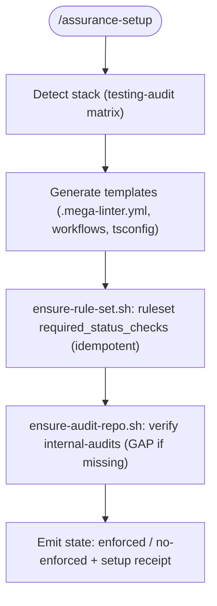

# /assurance-repo-setup — protocol SSOT

Generates the quality gate of `/assurance` (MegaLinter + typecheck + ruleset +
`internal-audits`) on the **repo side**: committed files and remote
configuration. It is **idempotent**. The **local** side (dev machine, hooks, deps)
lives in `/assurance-local-setup` — this protocol does not touch it.

## What it generates

| Artifact | Description |
|-----------|-------------|
| `.mega-linter.yml` | Linters per detected stack + typecheck `PRE_COMMANDS` |
| `.github/workflows/megalinter.yml` | CI gate (runs **always**: no `paths` filters) + SARIF/JSON artifacts |
| `.github/workflows/bypass-audit.yml` | Bypass detection and receipt persistence in `internal-audits` |
| `shared/hooks/tsconfig.json` (if TS) | ESM base for `tsc --noEmit` (typecheck) |
| Ruleset `required_status_checks` | Ensured by `ensure-rule-set.sh` (if permissions allow) |

## Lessons incorporated (do not improvise)

The following rules **are** the protocol; they come from observed errors:

1. **The check always runs.** The `megalinter` workflow does **not** have `on.<event>.paths`.
   A required check that sometimes does not run stays "nonexistent" and blocks the merge
   (permanent false positive).
2. **Typecheck is not native to MegaLinter.** It is injected as a `PRE_COMMAND`
   with `tsc --noEmit`. The `tsconfig` uses `module: ESNext` + `moduleResolution: Bundler`
   (ESM) and `typeRoots` pointing to `node_modules/@types`.
3. **`NODE_ENV=production` breaks `npm ci`** (omits devDeps → `TS2688`). That is why
   the pre-command uses **`npm ci --include=dev`**. Do not remove it.
4. **Rulesets ≠ classic branch protection.** The parameter is `required_status_checks`
   as an array of `{ "context": … }` (not `contexts`), within the ruleset. The helper
   `ensure-rule-set.sh` uses this format.
5. **The check is always a blocker; bypass is audited, not disabled.** There is never an
   "on/off" switch for the gate. Bypasses are evidence (see `internal-audits`).
6. **Evidence outside the product repo.** Receipts go to `internal-audits`
   (private internal repo). If it does not exist → **GAP** (setup does not fail).
7. **Evidence without PRs.** Direct push to `internal-audits`, immutable, keyed by
   `commit_sha`. Outside the review cycle.
8. **GHAS/code scanning may be missing.** Do not use `codeql/upload-sarif` as a required
   step: it can fail if the repo does not have GitHub Advanced Security. The
   evidence is saved as an **artifact** (`upload-artifact@v4`). (`upload-sarif`
   only as an optional step and with `codeql@v4`.)
9. **`codeql/upload-sarif@v3` enters deprecation** (Dec 2026). If used, make it
   `v4` and optional.
10. **Startup without ruleset → phased enforcement.** Setup reports the state
    ("enforced" vs "no-enforced") and documents the transition; it does not block for not
    being able to enable the ruleset.
11. **Auto-detected stack.** Reuses the matrix from
    `references/testing/assurance-testing-audit/protocol.md` to build `ENABLE`.

## Flow



## Arguments

```
/assurance-setup [repo] [--no-ruleset] [--audit-repo <org/repo>]
```

- `--no-ruleset` — do not attempt to touch the ruleset (only generate files).
- `--audit-repo` — evidence destination repo (default `chimeranext/internal-audits`).

## Post-verification

- `.mega-linter.yml` + workflows present.
- `git` does not duplicate files when re-run (idempotency).
- The `megalinter` check appears on the latest push.

## Related

- `references/governance/protocol.md` (`internal-audits` policy, enforcement phases)
- `references/testing/assurance-testing-audit/protocol.md` (stack matrix)
- `references/assurance-local-setup/protocol.md` (local side of the dev machine)
- `scripts/assurance-repo-setup/` (helpers y templates)
