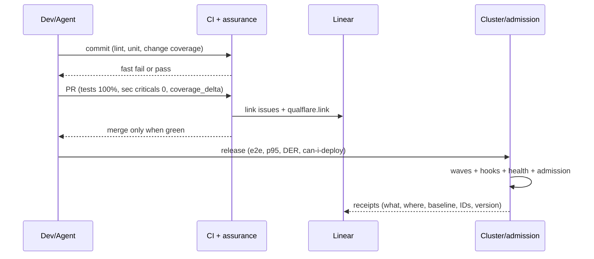

# Governance — protocol SSOT

It has no execution commands: it defines how things are measured, what blocks, and what stays as evidence.
Full behavior contract: `openspec/changes/add-assurance-toolkit/specs/toolkit/assurance-governance/spec.md`.

## Metrics (outcomes, not activity)

DORA (frequency, lead time, change fail rate, failed deployment recovery time, rework rate)
+ DER/DRE, MTTD/MTTR, flaky rate. Join via `found_env` + `commit_sha`; attribution 14 days;
`unattributed` as a signal. Anti-gaming: ratios, trends, no individual targets (Goodhart);
coverage as diagnosis.

## Gates per stage

- **commit**: lint, unit, coverage of the change. Aggregated lint via MegaLinter
  (`.mega-linter.yml`, GitHub Action) + typecheck `tsc --noEmit` as a blocking `PRE_COMMAND`
  (see `references/testing/assurance-testing-audit/protocol.md`).
- **PR**: tests 100%, security criticals 0, `coverage_delta` ≥ 0.
- **release**: e2e pass, p95, DER below threshold, `can-i-deploy` where applicable.
Cheap and fast first. Flaky = defect (quarantine, fix, or remove).

## Receipts (phase 7)

One receipt per verdict: what ran, where, against which baseline, with which IDs
(Linear, MASWE/MASTG, contract). Auditable release format.

### Evidence policy: `internal-audits` (opinionated)

Governance receipts and evidence **do not live in the product repo**.
They live in a dedicated private internal repo (`internal-audits` or equivalent), separate
from distributable code.

**Rationale** (why this policy):
- Avoids mixing auditable with distributable: the product repo is sold/shared
  (e.g. BSL) and must not carry internal governance.
- Avoids leaking internal signal (actors, gate bypasses, approvals, failures) to
  clients/public.
- Keeps retention and access control separate from the release chain.

**Rule**: the policy is opinionated for any repo that adopts assurance. A repo
may deviate, but must **document the deviation** (alternative destination and its
rationale). In the absence of `internal-audits`, the protocol emits **GAP** (see
`references/testing/assurance-testing-audit/protocol.md`).

**Receipt lifecycle**:
- Immutable: one file per event, keyed by `commit_sha` (+ timestamp). It is not
  rewritten; each event = a new file.
- Writing: the post-merge workflow/script does a **direct push** to `internal-audits`
  (that repo's `main` or `evidence/` branch), **without PRs or re-evaluation** — the
  evidence describes already-occurred events and must not re-enter the review cycle.
- Reading: metrics (bypass rate, typecheck status, etc.) are computed from
  `internal-audits`, not from the product repo.

**Retention**: quarterly cohorts; do not delete receipts linked to published
releases. Explicit pruning policy, reviewed in governance.

**Structure**: `evidence/receipts/<gate>/<yyyy-mm>/<sha>.json`.

## Migrated skills (flutter-boilerplate-monorepo-template, reinterpreted)

- **sre-slo-sli-sla**: SLOs, error budgets, MTTD/MTTR (SRE workbook); feeds outcome-based metrics.
- **cicd-argocd**: GitOps sync as a gate (waves/hooks/health) — see GitOps requirement.
- **cicd-github-actions**: wiring gates in CI (testing workflows → deploy).
- **sre-logging-log-aggregation**: Loki/ES/Fluentd, structured logs as evidence attached to receipts.
- **versioning-management**: SemVer + UNIVERSAL conventional commits (every repo, not just Flutter): commitlint on pre-push/CI, releases with release-please/semantic-release, changelog generated from history; version↔evidence linkage in each receipt. Same discipline as marketplace versioning (root `marketplace.json` + `plugin.json` together).
- **sre-alerting-incident-management (governance)**: SLA timers and breach alerts as dashboard metrics.

## GitOps pipeline + K8s pre-flight

Waves (infra first), Pre/PostSync hooks, `ignoreDifferences` as baseline, health
assessment, App of Apps. Pre-flight: each troubleshooting-guide failure is a gate
(probes, requests/limits, RBAC, quotas, HPA with metric, post-deploy smoke).

## Layered pre-flight (kubernetes.qa matrices)

kubeconform (schema+CRDs; kubeval forbidden) → kube-score (PR gate) → Trivy
(images+misconfig+secrets+SBOM) → Checkov (cross-IaC) + kubeaudit (security-only);
Kubescape (multi-framework posture + RBAC); kube-bench (CIS on nodes); kube-hunter
excluded (unmaintained). One owner per finding + one severity; Snyk only for its
dev workflow (Code + fix PRs).

## Contract gates + health score

Exit codes 0/1/2, per-env thresholds (dev:critical, prod:warning), audit-first,
diff against what is running. Deterministic health score 0–100 across 8 dimensions
(resources, security, networking, storage, availability, observability,
configuration, cost); minimums per dimension, exact remediation per finding.

## Release gates (sequence)

## References

- DORA: https://dora.dev/guides/dora-metrics/ · escape rate, MTTR, anti-gaming
- Gates: https://kubernetes.qa/features/gates/ (exit codes, per-env thresholds, audit-first, diff)
- Contratos: `can-i-deploy` (Pact Broker) como gate de deploy
- GitOps: `ArgoCD Up & Running` (O'Reilly 2025, local) — waves, hooks Pre/PostSync
- AI evals: Huyen `AI Engineering` Ch4/Ch10 (local) — eval-driven development
- Refactor: Fowler `Refactoring` 2e Ch4 (local) — self-testing, risk-driven, characterization tests
