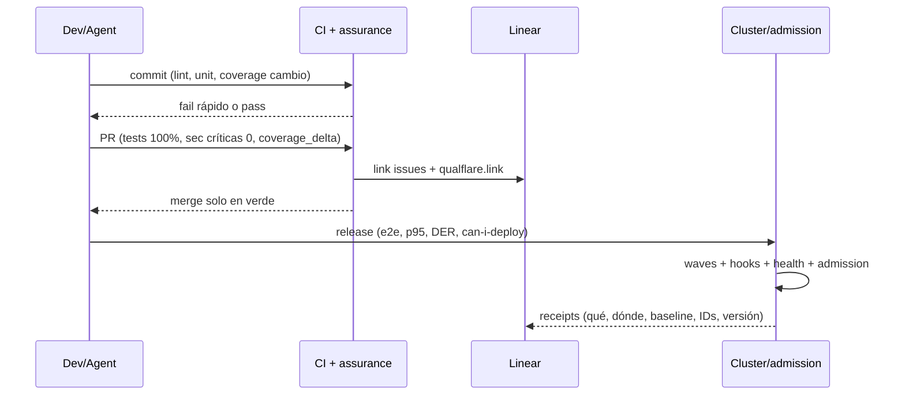

# Gobierno — protocol SSOT

No tiene comandos de ejecución: define cómo se mide, qué bloquea y qué queda como evidencia.
Full behavior contract: `openspec/changes/add-assurance-toolkit/specs/toolkit/assurance-governance/spec.md`.

## Métricas (outcomes, no actividad)

DORA (frequency, lead time, change fail rate, failed deployment recovery time, rework rate)
+ DER/DRE, MTTD/MTTR, flaky rate. Join vía `found_env` + `commit_sha`; atribución 14 días;
`unattributed` como señal. Anti-gaming: ratios, tendencias, sin targets individuales (Goodhart);
cobertura como diagnóstico.

## Gates por etapa

- **commit**: lint, unit, coverage del cambio. Lint agregado vía MegaLinter
  (`.mega-linter.yml`, GitHub Action) + typecheck `tsc --noEmit` como `PRE_COMMAND`
  bloqueante (ver `references/testing/assurance-testing-audit/protocol.md`).
- **PR**: tests 100%, security críticas 0, `coverage_delta` ≥ 0.
- **release**: e2e pass, p95, DER bajo umbral, `can-i-deploy` donde aplique.
Barato y rápido primero. Flaky = defecto (cuarentena, fix o remove).

## Receipts (fase 7)

Un receipt por veredicto: qué corrió, dónde, contra qué baseline, con qué IDs
(Linear, MASWE/MASTG, contrato). Formato auditable del release.

### Política de evidencia: `internal-audits` (opinada)

Los receipts y la evidencia de gobernanza **no viven en el repo de producto**.
Viven en un repo interno privado dedicado (`internal-audits` o equivalente), separado
del código distribuible.

**Rationale** (por qué esta política):
- Evita mezclar lo auditable con lo distribuible: el repo de producto se vende/comparte
  (p.ej. BSL) y no debe cargar gobernanza interna.
- Evita filtrar señal interna (actores, bypasses de gate, aprobaciones, fallos) a
  clientes/público.
- Mantiene retención y control de acceso separados de la cadena de release.

**Regla**: la política es opinada para cualquier repo que adopte assurance. Un repo
puede desviarse, pero debe **documentar la desviación** (destino alternativo y su
rationale). En ausencia de `internal-audits`, el protocolo emite **GAP** (ver
`references/testing/assurance-testing-audit/protocol.md`).

**Ciclo de vida del receipt**:
- Inmutable: un archivo por evento, keyed por `commit_sha` (+ timestamp). No se
  reescribe; cada evento = archivo nuevo.
- Escritura: workflow/script de post-merge hace **push directo** a `internal-audits`
  (rama `main` o `evidence/` de ese repo), **sin PRs ni re-evaluación** — la
  evidencia describe eventos ya ocurridos y no debe re-entrar al ciclo de review.
- Lectura: las métricas (bypass rate, typecheck status, etc.) se calculan desde
  `internal-audits`, no desde el repo de producto.

**Retención**: cohortes por trimestre; no borrar receipts vinculados a releases
publicados. Política de poda explícita, revisada en governance.

**Estructura**: `evidence/receipts/<gate>/<yyyy-mm>/<sha>.json`.

## Migrated skills (flutter-boilerplate-monorepo-template, reinterpretados)

- **sre-slo-sli-sla**: SLOs, error budgets, MTTD/MTTR (SRE workbook); alimenta métricas outcome-based.
- **cicd-argocd**: GitOps sync como gate (waves/hooks/health) — ver requirement GitOps.
- **cicd-github-actions**: wiring de gates en CI (workflows de testing → deploy).
- **sre-logging-log-aggregation**: Loki/ES/Fluentd, structured logs como evidencia adjunta a receipts.
- **versioning-management**: SemVer + conventional commits UNIVERSALES (todo repo, no solo Flutter): commitlint en pre-push/CI, releases con release-please/semantic-release, changelog generado del historial; linkage versión↔evidencia en cada receipt. Misma disciplina que el versionado del marketplace (root `marketplace.json` + `plugin.json` juntos).
- **sre-alerting-incident-management (gobierno)**: SLA timers y breach alerts como métricas del dashboard.

## Pipeline GitOps + pre-flight K8s

Waves (infra primero), hooks Pre/PostSync, `ignoreDifferences` como baseline, health
assessment, App of Apps. Pre-flight: cada fallo del troubleshooting guide es un gate
(probes, requests/limits, RBAC, quotas, HPA con métrica, smoke post-deploy).

## Pre-flight en capas (matrices kubernetes.qa)

kubeconform (schema+CRDs; kubeval prohibido) → kube-score (PR gate) → Trivy
(imágenes+misconfig+secrets+SBOM) → Checkov (cross-IaC) + kubeaudit (security-only);
Kubescape (posture multi-framework + RBAC); kube-bench (CIS en nodos); kube-hunter
excluido (unmaintained). Un owner por hallazgo + una severidad; Snyk solo por su
workflow dev (Code + fix PRs).

## Gates con contrato + health score

Exit codes 0/1/2, thresholds por env (dev:critical, prod:warning), audit-first,
diff contra lo corriendo. Health score determinista 0–100 en 8 dimensiones
(resources, security, networking, storage, availability, observability,
configuration, cost); mínimos por dimensión, remediación exacta por hallazgo.

## Release gates (sequence)

## References

- DORA: https://dora.dev/guides/dora-metrics/ · escape rate, MTTR, anti-gaming
- Gates: https://kubernetes.qa/features/gates/ (exit codes, thresholds por env, audit-first, diff)
- Contratos: `can-i-deploy` (Pact Broker) como gate de deploy
- GitOps: `ArgoCD Up & Running` (O'Reilly 2025, local) — waves, hooks Pre/PostSync
- AI evals: Huyen `AI Engineering` Ch4/Ch10 (local) — eval-driven development
- Refactor: Fowler `Refactoring` 2e Ch4 (local) — self-testing, risk-driven, characterization tests
