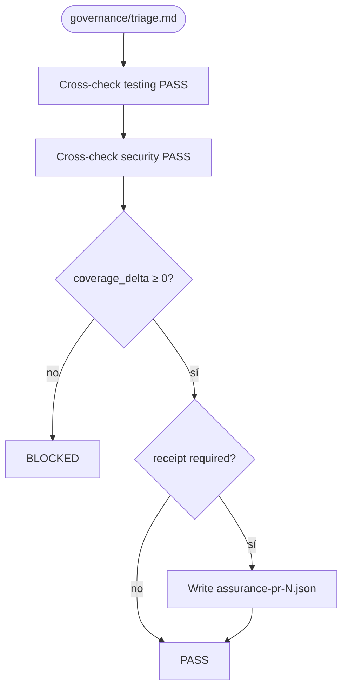
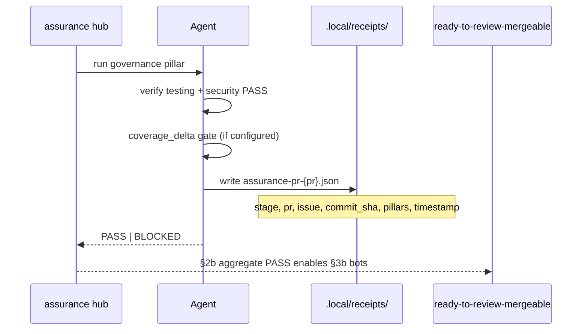

# governance — PR triage sub-protocol

Parent hub: [`references/triage/protocol.md`](../triage/protocol.md).

## Question

Do PR-stage **gates and receipts** allow moving to remote code review?

## Flow (PR stage)

## Sequence (hub aggregation → receipt)

## Steps

1. Apply PR-stage gates from [`references/governance/protocol.md`](../governance/protocol.md):
   - tests satisfied (cross-check testing pillar PASS),
   - security criticals = 0 (cross-check security pillar PASS),
   - `coverage_delta` ≥ 0 when the repo measures it.
2. Emit or update a **PR receipt** when config requires it
   (`readyToReview.assurance.receipt.path`, default
   `.local/receipts/assurance-pr-<pr>.json`):
   - `stage: pr`, `pr`, `issue`, `commit_sha`, `pillars` verdict map, `timestamp`.
3. **BLOCK** if a required gate or receipt field is missing.
4. **PASS** when gates are met and receipt (if required) is written.

## Out of scope

- Release-stage gates (e2e full suite, p95, DER thresholds) — unless explicitly
  promoted to PR via consumer config.
