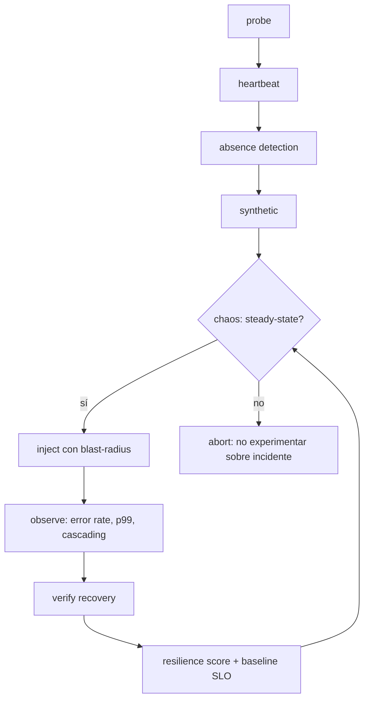

# Pilar liveness — protocol SSOT

Harness-agnostic body. Thin entry: `commands/observability-audit.md`.
Full behavior contract: `openspec/changes/add-assurance-toolkit/specs/toolkit/assurance-liveness/spec.md`.

## Principio

¿Sigue vivo? Corre siempre (schedule/daemon), no por PR. Distingue "pasa" de "dejó de pasar".

## Escalera

probe → heartbeat → absence → synthetic, en ese orden. `observability-audit` verifica
telemetría recibida (no solo emitida), credencial contra destino vivo, init paths que no
apagan monitoreo en silencio, canales de alerta con tráfico real y dueños, y que cada
alerta demostró poder disparar.

## Chaos (a PoC)

Experimentos como CRDs versionados: hipótesis SLO medible, probes, blast radius acotado,
abort criteria con auto-stop. Matriz Litmus (hub, GitOps, ChaosCenter, MCP) vs Chaos Mesh
(faults granulares, dashboard). Staging primero; prod solo con guardrails. Antithesis
(simulación determinista, properties, replay) en evaluación para sistemas con estado.

## Baselines

p95/p99 de perf → baselines versionadas que liveness vigila. Al cambiar de herramienta,
re-baselinear (métricas no comparables entre herramientas).

## Migrated skills (flutter-boilerplate-monorepo-template, reinterpretados)

- **flutter-error-tracking**: Sentry/Crashlytics + breadcrumbs + source maps; errores como señal MTTD.
- **sre-observability-stack**: Prometheus/Grafana/Jaeger/OTel; liveness, heartbeat, absence-detection.
- **sre-alerting-incident-management**: PagerDuty/Opsgenie, on-call, monitoring-as-code; cada alerta con dueño y runbook linkeado.
- **sre-chaos-engineering**: Litmus, failure injection, game days (principlesofchaos); alimenta la PoC Litmus vs Chaos Mesh.
- **sre-database-reliability (liveness)**: replication lag y failover readiness como señales; drills en testing.

## Playbook + runbooks (taxonomía fractional-cto 08/09)

El **playbook** decide (árbol diagnose/recover/escalate, pattern-IDs MDAA/MASWE);
los **runbooks** ejecutan (diagnose read-only con Events → stern → k9s, recover/restore).
Prosa sin árbol ni trigger = post-mortem, no playbook/runbook.

## Liveness loop

## References

- K8s troubleshooting: `FINAL_The Ultimate Kubernetes Throubleshooting Guide_26.03.2026.pdf` (Documentos, local) — señales Events → stern → k9s
- K8s Book (Poulton 2024, local): Deployments, RBAC (ch14), threat modeling (ch16)
- Chaos: https://litmuschaos.io/ · https://chaos-mesh.org/ · https://kubernetes.qa/features/chaos/ · Antithesis https://antithesis.com/ (deterministic simulation, en evaluación)
- Health: https://kubernetes.qa/features/health/ (8 dimensiones, score determinista)
- Sysinternals: https://learn.microsoft.com/en-us/sysinternals/resources/troubleshooting-book (ProcDump por criterios, casos "Unexplained")
- MDAA Diagnomicon (Vostokov, local): pattern-IDs estables para diagnósticos
