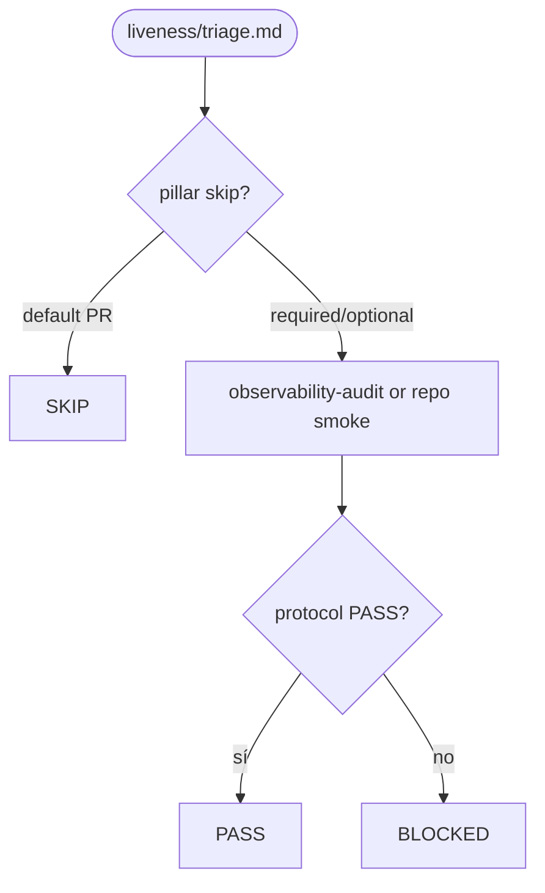
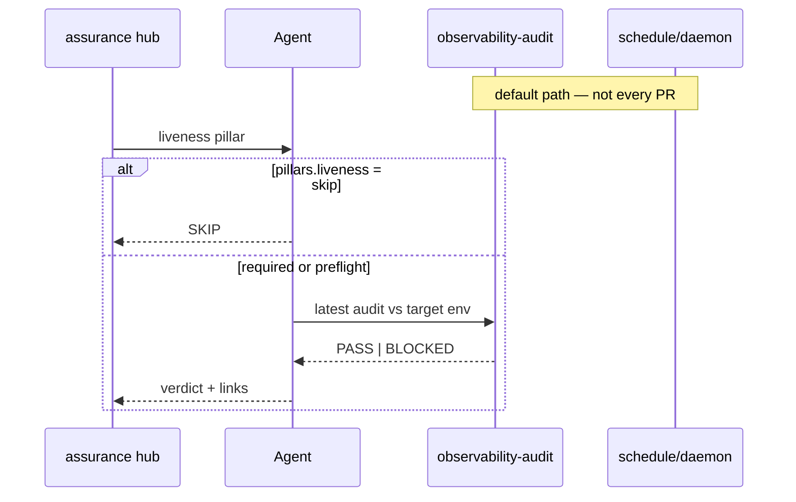

# liveness — PR triage sub-protocol

Parent hub: [`references/triage/protocol.md`](../triage/protocol.md).

## Question

Does this PR require **liveness** evidence before code review?

## Default (PR stage)

**SKIP** — liveness (`observability-audit`, chaos, heartbeat) runs on **schedule /
daemon** cadence, not on every PR. See assurance README pillar table.

## Flow (when pillar not skip)

## Sequence (schedule vs PR opt-in)

## When not SKIP

If `readyToReview.assurance.pillars.liveness` is `required` or `optional`, or
`readyToReview.assurance.liveness.preflight` is true:

1. Run or verify the latest `observability-audit` (or repo-defined smoke) against
   the target environment documented in config.
2. **PASS** / **BLOCK** per that audit's protocol
   [`references/liveness/protocol.md`](../liveness/protocol.md).
