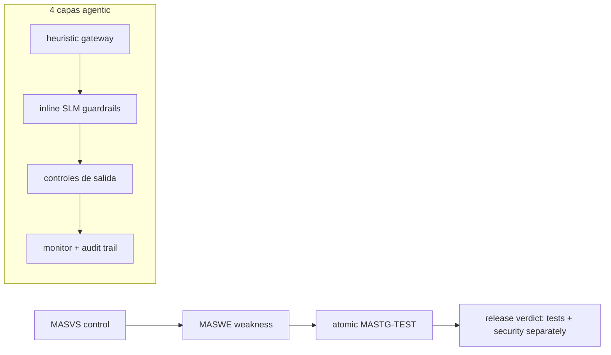

# Transversal security — protocol SSOT

Harness-agnostic body. Thin entries: `commands/triage.md` (mode `security`
runs [`findings-protocol.md`](findings-protocol.md)),
`commands/pentest-runner.md`, `commands/pentest-playbook-setup.md`.
PR-stage hub:
[`references/triage/protocol.md`](../triage/protocol.md); security PR gate:
[`triage.md`](triage.md).
Full behavior contract: `openspec/changes/add-assurance-toolkit/specs/toolkit/assurance-security/spec.md`.

## Principle

Is it secure? Own cadence (pentest per release, triage per SLA), own runner,
reports never mixed with tests. Each release requires separate verdicts.

## Components

- **pentest-runner**: authorized execution (Kill Chain + OWASP). Triage pattern shared
  with testing (queue → owner → SLA → receipt), different owners.
- **pentest-playbook-setup**: audit/sync of playbook ↔ CI ↔ tenant config (only JSON in sync).
- **`/assurance:triage security`**: findings → owned backlog, no duplicate issues (dedupe by signature). See [`findings-protocol.md`](findings-protocol.md).
- **MASVS → MASWE → MASTG v2 traceability**: each mobile finding with stable IDs and profile
  (MAS-L1/L2/R/P) per threat model; fix via MASTG-BEST. Model for receipts.
- **Automated pre-layer**: Semgrep (SAST), ZAP (DAST), Trivy/Grype + Dependency-Track
  (SCA over SBOM), dependency-review on PR. Criticals block.
- **Supply-chain**: canonical SBOM (CycloneDX/SPDX) per build + continuous scanning, keyless signing
  Sigstore/cosign, SLSA provenance (L2/L3), fail-closed admission (Kyverno).
  Generating without gates is dashboard, not control.

## Migrated skills (flutter-boilerplate-monorepo-template, reinterpreted)

- **flutter-security**: certificate pinning, secure storage, obfuscation, biometrics, root/jailbreak detection → maps to mobile MASVS.
- **sre-security-compliance-automation**: OPA policy-as-code, CIS benchmarks, continuous vulnerability scanning.
- **sre-container-security**: image scanning + signing (notary/cosign), Falco runtime, CVE → supply-chain.
- **sre-network-policies-security**: Calico/Cilium, egress/ingress as verifiable controls in gates.
- **static-analysis**: multi-language lint as an SAST gate (dart-analyze, ruff, golangci-lint, eslint, shellcheck, clippy, super-linter).

## Red-team agentic (OWASP ASI01–ASI10 + LLM02)

Method in 4 phases (Build → Audit with scenario maps → Define controls → Monitor & iterate);
priorities Foundation (ASI01/02/PII) → Coverage → Depth → Extension.
Layered defenses, SoD, gateway + code layer. Training-data alignment with
OWASP-aligned suites. Zero-tolerance PII (contextual detectors, tenant-scoped SQL).

## Source-less mobile supply-chain (REA model)

Flutter via snapshot hash + engine provenance (static APK parsing); APKs via
decompiled manifest/classes (JADX). Every finding with evidence + explicit limitations,
same format as receipts.

## Runtime K8s: detect vs prevent + policy engines

- **Falco** (detect/alert, graduated) cluster-wide → triage/SIEM; **KubeArmor** (LSM)
  or **Tetragon** (eBPF, Cilium synergy) on high-value workloads. Audit-first.
- **Kyverno** default K8s (YAML, mutate/generate, image verification) vs **Gatekeeper**
  (Rego, cross-platform reuse). Admission = backstop, pair with CI-stage scanning.

## Traceability + layered defense

## References

- MASVS/MASTG/MASWE: https://mas.owasp.org/MASVS/ · https://mas.owasp.org/MASTG/ (v2: 285 tests, 152 demos)
- OWASP Agentic AI: Galileo `Operationalizing the OWASP Top 10 for Agentic AI` (local PDF, Apr-2026) — ASI01–ASI10, control plane, SoD, 4 phases
- Supply chain: https://slsa.dev/ · Sigstore/cosign · SBOM CycloneDX/SPDX
- Scanners: Trivy/Grype, Semgrep, OWASP ZAP, Kubescape, Checkov
- Runtime: Falco (graduated) + KubeArmor (LSM) / Tetragon (eBPF) — see kubernetes.qa matrices
- Mobile REA: https://github.com/morluto/rea (MIT) — source-less APK/Flutter, evidence + limitations
