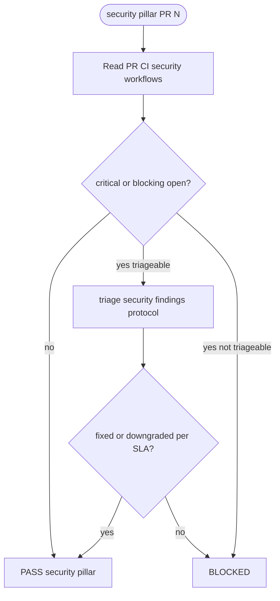
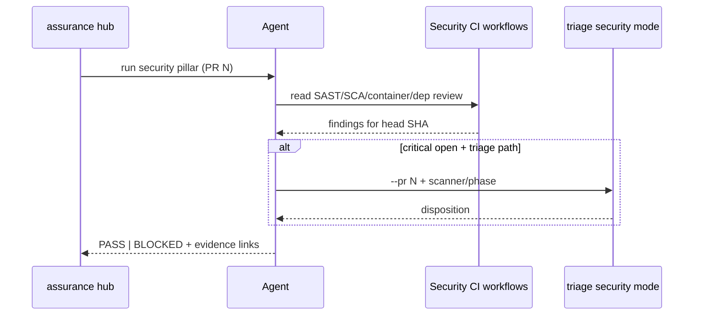

# security — PR triage sub-protocol

Parent hub: [`references/triage/protocol.md`](../triage/protocol.md).

## Question

Is this PR **safe to expose to code review** under PR-stage security gates
(critical findings = 0)?

## Flow (PR stage)

## Sequence (agent ↔ scanners)

## Steps

1. Read PR CI / security workflows (SAST, SCA, container scan, dependency review —
   whatever the repo wires). Align with [`references/security/protocol.md`](../security/protocol.md).
   Map the wired gates against the vendored ci-checks catalog
   (`shared/references/ci/ci-checks.yml`) and its gap analysis
   (`shared/references/ci/security-tooling-gap.md`): the triage PASS requires the
   repo's SAST/SCA/container/dep-review gates to cover the catalog baseline
   (CodeQL/SAST, Trivy/SCA+container, dependency-review). Coverage gaps are
   findings, not silent skips.
2. **PASS** when no **critical** (or repo-defined blocking) security findings remain
   open for this PR head SHA.
3. When findings exist but are triageable, stay in this mode. Follow
   [`findings-protocol.md`](findings-protocol.md) as
   **`/assurance:triage security`** with `--pr N` and the scanner or phase
   argument (`list`, `dry-run`, `phase2`, `phase7`, `manual`, `pentest-report`,
   or a scanner id) per tenant config (`securityFindingTriage` in
   `linear-setup.json` when present). There is no second slash command.
   **BLOCK** until criticals are fixed or explicitly downgraded per tenant SLA
   policy (document in hub report; never silent).
4. Do **not** substitute local diff security review for failing CI security gates
   when CI is available.

## Out of scope

- Full pentest (`pentest-runner`) — release cadence unless config forces pre-PR.
- Merging security and test reports into one narrative (separate verdicts).
