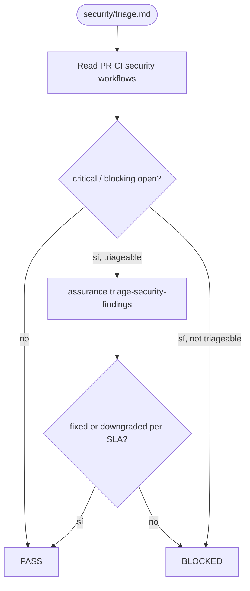
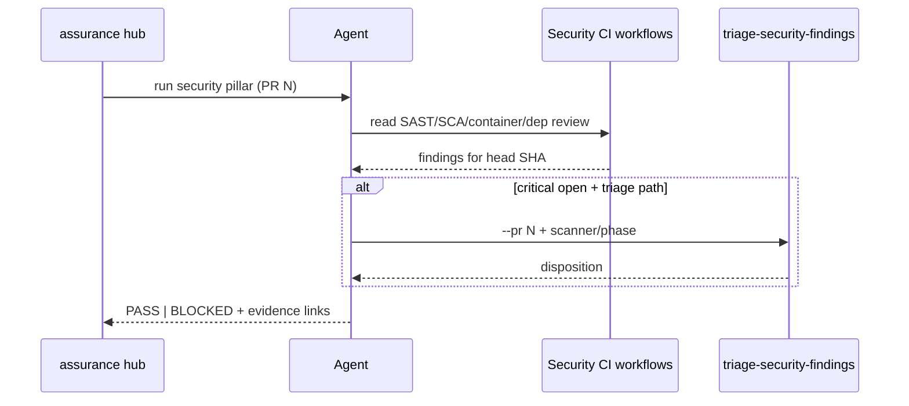

# security — PR triage sub-protocol

Parent hub: [`references/triage/protocol.md`](../triage/protocol.md).

## Question

Is this PR **safe to expose to code review** under PR-stage security gates
(critical findings = 0)?

## Flow (PR stage)

## Sequence (agent ↔ scanners)

## Steps

1. Read PR CI / security workflows (SAST, SCA, container scan, dependency review —
   whatever the repo wires). Align with [`references/security/protocol.md`](../security/protocol.md).
2. **PASS** when no **critical** (or repo-defined blocking) security findings remain
   open for this PR head SHA.
3. When findings exist but are triageable:
   - Invoke **`/assurance:triage-security-findings`** (or
     `make-no-mistakes:triage-security-findings` shim) with `--pr N` and the
     appropriate scanner/phase argument per tenant config (`securityFindingTriage`
     in `linear-setup.json` when present).
   - **BLOCK** until criticals are fixed or explicitly downgraded per tenant SLA
     policy (document in hub report; never silent).
4. Do **not** substitute local diff security review for failing CI security gates
   when CI is available.

## Out of scope

- Full pentest (`pentest-runner`) — release cadence unless config forces pre-PR.
- Merging security and test reports into one narrative (separate verdicts).
