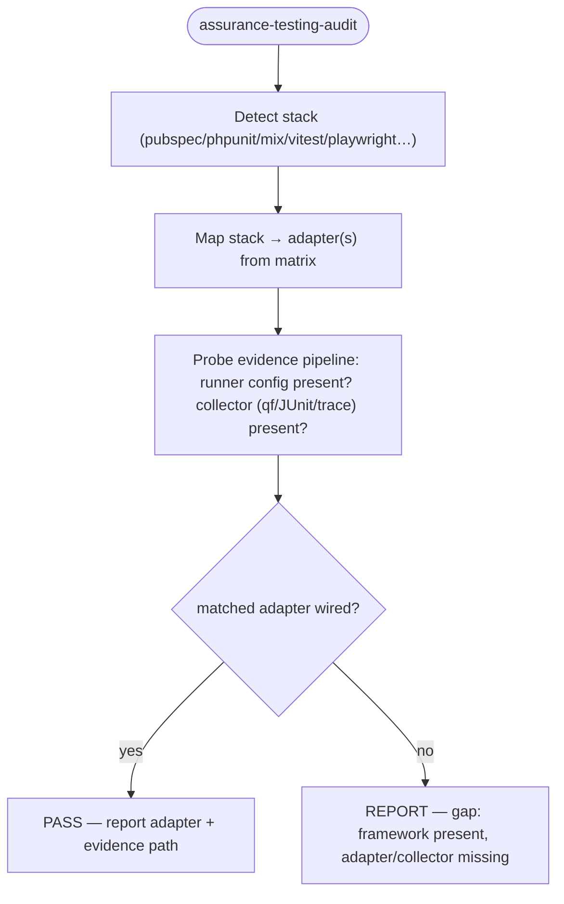

# /assurance-testing-audit — protocol SSOT

Harness-agnostic body. Thin entry: `commands/assurance-testing-audit.md`.

## Question

Does this repo actually use a supported testing framework for the **stack it ships**, and is
that framework wired into the evidence pipeline (run → collect → link to Linear → cluster)?
This audit is a **static repo scan + minimal probe**, not a full run. It reports which
runners apply and whether the adapter evidence path exists.

## Framework matrix (what we look for)

| Stack in repo | Adapter | Probe |
| --- | --- | --- |
| Flutter/Dart | `flutter test` + `integration_test` + Maestro | `pubspec.yaml` (flutter), `.maestro/` flows, `integration_test/` |
| Flutter (mobile E2E) | Maestro (YAML) / MobileWright (PoC) / Patrol | `.maestro/*.yaml`, `mobilewright.config`, `patrol` dep |
| Web | Playwright / Cypress / Vitest-Jest | `playwright.config`, `cypress.config`, `vitest.config`, `jest.config` |
| Laravel/PHP | Pest/PHPUnit (`php artisan test`) | `phpunit.xml`, `tests/` |
| Elixir | ExUnit (`mix test`) | `mix.exs`, `test/` |
| TypeScript | Vitest/Jest + `tsgo` TS7 checklist | `vitest.config.ts`, `jest.config.ts`, `tsconfig.json` |
| API/contracts | Schemathesis / Pact | `openapi.*`, `pact/`, `schemathesis` config |
| Mobile collectors | Qualflare (`qf collect`) | `qualflare` config / `qf` in CI |

## Flow

## Steps

1. Detect the repo stack (files above). Multiple stacks → one row each.
2. Map each detected stack to its adapter row in the matrix.
3. Probe the evidence path: is a runner config present, and is a collector wired
   (Qualflare `qf`, JUnit output, Playwright `trace.zip`, Maestro report)?
4. Emit one row per stack: `stack → adapter → evidence → verdict`.
5. Verdict: **PASS** when adapter is wired; **GAP** when the framework is present but
   the adapter/collector is missing (this is the actionable output); **N/A** when the
   framework is absent.

## Out of scope

- Executing the suites (that's the runner / `e2e-test-runner`).
- Security column (separate verdicts).
- `coverage_delta` (governance).

## References

- Maestro MCP / Flutter: https://docs.maestro.dev/get-started/maestro-mcp · https://docs.maestro.dev/get-started/supported-platform/flutter · https://docs.maestro.dev/get-started/quickstart
- MobileWright: https://github.com/mobile-next/mobilewright
- Qualflare: https://github.com/Qualflare/qualflare-flutter · qualflare-maestro · qualflare-playwright · qualflare-claude-code · qualflare-vitest · qualflare-webdriverio
- Full adapter matrix: `specs/toolkit/assurance-testing/spec.md`
