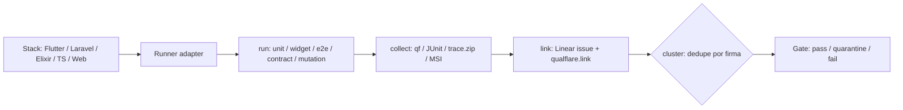

# Pilar testing — protocol SSOT

Harness-agnostic body for the testing pillar (evidence, stack runners, gates).
Full behavior contract: `openspec/changes/add-assurance-toolkit/specs/toolkit/assurance-testing/spec.md`.

The TestSprite suite commands are separate protocols. This file does not replace them:

| Command | Protocol |
| --- | --- |
| `/assurance:e2e-test-builder` | [`references/e2e-test-builder/protocol.md`](../e2e-test-builder/protocol.md) — write `test-suite.json` |
| `/assurance:e2e-test-runner` | [`references/e2e-test-runner/protocol.md`](../e2e-test-runner/protocol.md) — execute that suite |
| `/assurance:e2e-test-preview` | [`references/e2e-test-preview/protocol.md`](../e2e-test-preview/protocol.md) — Qt preview of that suite |
| Preparación ISTQB | Academy `docs/certificaciones-istqb/` — exam structure, weights, strategy per certification (moved from this repo to the academy) |
| Entrevistas QA | Academy `docs/certificaciones-istqb/qa-interview-teachings.md` — practical answers from interview transcripts |

## Principio

Un protocolo de evidencia (run → collect → link a Linear → cluster), runners por stack.
Los stacks iniciales son los primeros adapters, no una lista cerrada (ver matriz + PoC en spec).

## Runners

- **Flutter/Dart por niveles**: unit `flutter test` + mockito, widget `WidgetTester`,
  integración `integration_test` en device + Maestro YAML (`Semantics.identifier`, Flutter 3.19+).
  `flutter_driver` = legacy. Patrol gris (regresión dev-owned) + Maestro humo (QA-owned).
- **Component testing**: stories CSF / scenarios Widgetbook como unidades portables
  (render + play + a11y + visual + coverage + unit + E2E vía iframe). Vitest addon en Vite;
  test-runner sin Vite. Tags gobiernan la suite.
- **Laravel/Pest**: `php artisan test`, `--parallel` (paratest + DBs por token),
  `--coverage --min`, `--profile`, suite `tests/Architecture` (arch-testing).
- **Elixir/ExUnit**: `mix test`, Phoenix/Ecto, PropEr/StreamData, Mox con contratos explícitos.
- **TypeScript 7**: checklist `tsgo` (versión única, sin `baseUrl`, plan compiler API, CI dual, sharp edges).
- **Playwright web**: golden rules (getByRole, sin `waitForTimeout`, web-first assertions,
  aislamiento, baseURL, retries 2/0, traces `on-first-retry`), cuarentena con salida
  (`fail` > `skip`, `@critical` exento), trust boundary. UI mode + `trace.zip` como evidencia.
- **MobileWright** (PoC): API Playwright-style móvil, fixtures `screen`/`device`,
  metadata `testResult` → evidencia. Maestro sigue default mobile-first hasta la PoC.
- **Mutación**: Infection / Stryker / muex; MSI como gate, scope incremental.
- **Contratos**: Schemathesis primero (sin infra), Pact + `can-i-deploy` después; Microcks/Prism mocks.
- **Perf**: k6 / Locust / Gatling / JMeter por lenguaje; thresholds → exit code; p95/p99 a SLOs.
- **A11y**: axe-core (web), Axe DevTools Mobile + Maestro, guidelines Flutter por celda +
  semantics diff; critical/serious bloquean, moderate/minor advierten.
- **Visual/PBT**: `toHaveScreenshot` con umbral; fast-check / Hypothesis / PropEr.

## Stack QA (Kiwi + Qualflare) y Storybook interaction testing

El stack QA del equipo usa **Kiwi** y **Qualflare** como plataformas principales. Este
pilar los integra de la siguiente forma:

- **Kiwi** — orquestación/gestión de tests QA (casos, ejecución, reportes). Es la capa
  de gestión QA; su salida se consume como evidencia.
- **Qualflare** — ejecución y trazabilidad de tests (vínculo a issues, `qualflare.link`).
  En el pipeline de evidencia, la collection se enlaza vía `qualflare.link` (ver
  `Evidence pipeline`).
- **Storybook interaction testing** — para componentes UI, se usan los tests de
  interacción de Storybook (`play` functions, `userEvent`, assertions sobre el behavior
  tras interactuar). Estos tests validan que un componente se comporta como se espera al
  recibir interacción del usuario.

### Regla: BDD ocurre ANTES

Los tests de componente/Storybook (y los de integración) **nunca reemplazan** la
especificación de comportamiento. El orden correcto es:

1. **BDD primero** — el escenario (Given/When/Then) se define en el OpenSpec / `test-suite.json`
   y expresa el comportamiento observable esperado. Es la fuente de verdad de *qué* debe pasar.
2. **Después** los tests de Storybook/componente implementan esa afirmación de comportamiento
   a nivel de UI (el `Then` del escenario se convierte en la assertion de la `play` function).
   - Un test de Storybook sin un escenario BDD que lo respalde es **sospechoso**: puede
     cubrir implementación, no comportamiento. No cuenta como evidencia de comportamiento.
   - La `play` function debe afirmar **comportamiento observable** (el resultado visible/
     de estado tras la interacción), no detalles de implementación interna.

Esto se alinea con el gate BDD (afirmar comportamiento observable) y con los insights de
`qa-interview-teachings` (el behavior es lo que se evalúa; los tests de componente cubren
la capa UI de un escenario ya definido en BDD).

## Reglas de gate

- Golden rules exigibles antes del merge; taxonomía de flakes dirige el fix (nunca subir timeouts).
- Reportes de tests nunca mezclados con reportes de seguridad (veredictos separados).
- **BDD**: afirmar comportamiento observable, no implementación interna. Un test pasa solo
  cuando su `Then` (el criterio legible) se cumple por evidencia observable — no por "el
  runner salió 0". Ver `references/e2e-test-runner/protocol.md` §Gates.
- **Jidoka**: ante cualquier anomalía (output inesperado, timeout, error, respuesta vacía),
  detener el run y registrar la anomalía + boundary + hipótesis de causa raíz. No continuar
  "a ver si el resto pasa". Un test con anomalía es `failed`, nunca `passed`.
- **No-Workarounds**: un test no puede marcarse `passed` si para lograrlo se silenció
  stderr, se hicieron cast de tipo, se tragó una excepción, se añadió sleep/retry
  arbitrario, se monkey-patcheó un boundary, o se copió-pegó sin ajustar. Eso es `failed`;
  la solución es corregir la fuente, no el síntoma.
- Estos gates aplican a todo runner del pilar (unit, widget, e2e, contrato, mutación, perf,
  a11y, visual). El formato de veredicto por test incluye el veredicto de cada gate.

## Eval-driven + risk-driven (Huyen + Fowler)

- **Eval-driven development**: criterios medibles primero (factual consistency local/global, safety, capabilities); benchmarks con desconfianza; judges especializados y calibrados; feedback conversacional como dato.
- **Risk-driven**: testear lo que más preocupa; incompletos que corren > completos inexistentes; auto-verificantes, frecuentes, aislados; characterization tests antes de refactorizar legacy.

## Migrated skills (flutter-boilerplate-monorepo-template, reinterpretados)

- **flutter-testing-strategy**: pirámide unit/widget/integration + TDD; correr desde la raíz del proyecto.
- **flutter-mobile-testing**: device testing vía Dart/Flutter MCP + Mobile Next MCP; inspección del widget tree en vivo (RenderFlex overflow), sims + devices reales.
- **flutter-accessibility**: Semantics, TalkBack/VoiceOver, focus management, contraste; mapea al gate a11y escalonado.
- **flutter-performance**: rebuilds, listas, memoria, lazy loading, profiling; resultados → baselines de SLOs.
- **sre-load-testing-performance**: recetas k6/JMeter, stress, capacity planning, benchmarking.

## Evidence pipeline

## References

- Flutter/Dart: https://docs.flutter.dev/testing · https://dart.dev/tools/testing · https://api.flutter.dev/flutter/flutter_test/ · https://api.flutter.dev/flutter/flutter_driver/
- Maestro: https://maestro.dev/insights/maestro-flutter-integration-testing · https://maestro.dev/insights/top-5-end-to-end-testing-frameworks-compared
- Patrol vs Maestro: https://leancode.co/blog/patrol-vs-maestro-flutter-e2e-testing · https://devicelab.dev/blog/flutter-testing-maestro-patrol-appium
- Storybook: https://storybook.js.org/docs/writing-tests/interaction-testing · https://storybook.js.org/docs/writing-tests/integrations/vitest-addon · https://storybook.js.org/docs/writing-tests/integrations/stories-in-end-to-end-tests · https://storybook.js.org/docs/writing-tests/accessibility-testing
- Widgetbook: https://docs.widgetbook.io/~v4/core-concepts · https://docs.widgetbook.io/~v4/testing/create-scenario · https://docs.widgetbook.io/glossary/golden-tests · https://www.widgetbook.io/blog/accessibility-testing-for-flutter
- Laravel/Pest: https://laravel.com/docs/testing · https://www.honeybadger.io/blog/laravel-pest-architecture-testing/
- Elixir: https://github.com/WTTJ/elixir-backend-learning-path#testing-your-code
- TypeScript 7: https://code.visualstudio.com/blogs/2026/06/26/iterating-faster-with-ts-7 · https://www.prisma.io/blog/typescript-7-native-compiler-faster-type-checking
- Playwright: https://playwright.dev/docs/writing-tests · skill `testdino-hq/playwright-skill` (MIT)
- MobileWright: https://mobilewright.dev/docs · https://github.com/mobile-next/mobilewright (Apache-2.0)
- Mutation: https://stryker-mutator.io/docs/ · https://infection.github.io/guide/
- Contracts: https://schemathesis.io/ · https://docs.pact.io/
- Load: k6 / Locust / Gatling / JMeter (ver matrices en spec)
- A11y engine: https://github.com/dequelabs/axe-core
