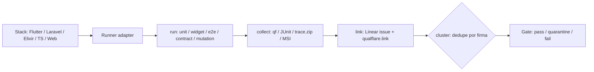

# Testing pillar — protocol SSOT

Harness-agnostic body for the testing pillar (evidence, stack runners, gates).
Full behavior contract: `openspec/changes/add-assurance-toolkit/specs/toolkit/assurance-testing/spec.md`.

The TestSprite suite commands are separate protocols. This file does not replace them:

| Command | Protocol |
| --- | --- |
| `/assurance:e2e-test-builder` | [`references/e2e-test-builder/protocol.md`](../e2e-test-builder/protocol.md) — write `test-suite.json` |
| `/assurance:e2e-test-runner` | [`references/e2e-test-runner/protocol.md`](../e2e-test-runner/protocol.md) — execute that suite |
| `/assurance:e2e-test-preview` | [`references/e2e-test-preview/protocol.md`](../e2e-test-preview/protocol.md) — Qt preview of that suite |
| ISTQB preparation | Academy `docs/certificaciones-istqb/` — exam structure, weights, strategy per certification (moved from this repo to the academy) |
| QA interviews | Academy `docs/certificaciones-istqb/qa-interview-teachings.md` — practical answers from interview transcripts |

## Principle

An evidence protocol (run → collect → link to Linear → cluster), runners per stack.
The initial stacks are the first adapters, not a closed list (see matrix + PoC in spec).

## Runners

- **Flutter/Dart by levels**: unit `flutter test` + mockito, widget `WidgetTester`,
  integration `integration_test` on device + Maestro YAML (`Semantics.identifier`, Flutter 3.19+).
  `flutter_driver` = legacy. Patrol gray (dev-owned regression) + Maestro smoke (QA-owned).
- **Component testing**: stories CSF / Widgetbook scenarios as portable units
  (render + play + a11y + visual + coverage + unit + E2E via iframe). Vitest addon in Vite;
  test-runner without Vite. Tags govern the suite.
- **Laravel/Pest**: `php artisan test`, `--parallel` (paratest + DBs per token),
  `--coverage --min`, `--profile`, suite `tests/Architecture` (arch-testing).
- **Elixir/ExUnit**: `mix test`, Phoenix/Ecto, PropEr/StreamData, Mox with explicit contracts.
- **TypeScript 7**: checklist `tsgo` (single version, no `baseUrl`, compiler API plan, dual CI, sharp edges).
- **Playwright web**: golden rules (getByRole, no `waitForTimeout`, web-first assertions,
  isolation, baseURL, retries 2/0, traces `on-first-retry`), quarantine with exit
  (`fail` > `skip`, `@critical` exempt), trust boundary. UI mode + `trace.zip` as evidence.
- **MobileWright** (PoC): mobile Playwright-style API, fixtures `screen`/`device`,
  metadata `testResult` → evidence. Maestro stays default mobile-first until the PoC.
- **Mutation**: Infection / Stryker / muex; MSI as gate, incremental scope.
- **Contracts**: Schemathesis first (no infra), Pact + `can-i-deploy` after; Microcks/Prism mocks.
- **Perf**: k6 / Locust / Gatling / JMeter per language; thresholds → exit code; p95/p99 to SLOs.
- **A11y**: axe-core (web), Axe DevTools Mobile + Maestro, per-cell Flutter guidelines +
  semantics diff; critical/serious block, moderate/minor warn.
- **Visual/PBT**: `toHaveScreenshot` with threshold; fast-check / Hypothesis / PropEr.

## QA Stack (Kiwi + Qualflare) and Storybook interaction testing

The team's QA stack uses **Kiwi** and **Qualflare** as primary platforms. This
pillar integrates them as follows:

- **Kiwi** — orchestration/management of QA tests (cases, execution, reports). It is the
  QA management layer; its output is consumed as evidence.
- **Qualflare** — test execution and traceability (link to issues, `qualflare.link`).
  In the evidence pipeline, the collection is linked via `qualflare.link` (see
  `Evidence pipeline`).
- **Storybook interaction testing** — for UI components, Storybook's interaction tests are
  used (`play` functions, `userEvent`, assertions about behavior after interacting). These
  tests validate that a component behaves as expected when receiving user interaction.

### Rule: BDD happens FIRST

Component/Storybook tests (and integration tests) **never replace** the
behavior specification. The correct order is:

1. **BDD first** — the scenario (Given/When/Then) is defined in the OpenSpec / `test-suite.json`
   and expresses the expected observable behavior. It is the source of truth for *what* must happen.
2. **Afterwards** the Storybook/component tests implement that behavior assertion at the UI
   level (the scenario's `Then` becomes the assertion of the `play` function).
   - A Storybook test without a supporting BDD scenario is **suspicious**: it may cover
     implementation, not behavior. It does not count as behavior evidence.
   - The `play` function must assert **observable behavior** (the visible/state result after
     interaction), not internal implementation details.

This aligns with the BDD gate (assert observable behavior) and with the insights from
`qa-interview-teachings` (behavior is what is evaluated; component tests cover the UI layer
of a scenario already defined in BDD).

## Gate rules

- Golden rules enforceable before merge; flake taxonomy drives the fix (never bump timeouts).
- Test reports never mixed with security reports (separate verdicts).
- **BDD**: assert observable behavior, not internal implementation. A test passes only
  when its `Then` (the readable criterion) is satisfied by observable evidence — not because
  "the runner exited 0". See `references/e2e-test-runner/protocol.md` §Gates.
- **Jidoka**: on any anomaly (unexpected output, timeout, error, empty response),
  stop the run and record the anomaly + boundary + root-cause hypothesis. Do not continue
  "to see if the rest passes". A test with an anomaly is `failed`, never `passed`.
- **No-Workarounds**: a test cannot be marked `passed` if achieving it required silencing
  stderr, type casts, swallowing an exception, adding arbitrary sleep/retry,
  monkey-patching a boundary, or copy-pasting without adjusting. That is `failed`;
  the fix is to correct the source, not the symptom.
- These gates apply to every runner of the pillar (unit, widget, e2e, contract, mutation, perf,
  a11y, visual). The per-test verdict format includes each gate's verdict.

## Eval-driven + risk-driven (Huyen + Fowler)

- **Eval-driven development**: measurable criteria first (factual consistency local/global, safety, capabilities); benchmarks treated with distrust; specialized and calibrated judges; conversational feedback as data.
- **Risk-driven**: test what worries you most; incomplete tests that run > complete ones that don't exist; self-verifying, frequent, isolated; characterization tests before refactoring legacy.

## Migrated skills (flutter-boilerplate-monorepo-template, reinterpreted)

- **flutter-testing-strategy**: unit/widget/integration pyramid + TDD; run from the project root.
- **flutter-mobile-testing**: device testing via Dart/Flutter MCP + Mobile Next MCP; live widget tree inspection (RenderFlex overflow), sims + real devices.
- **flutter-accessibility**: Semantics, TalkBack/VoiceOver, focus management, contrast; maps to the staggered a11y gate.
- **flutter-performance**: rebuilds, lists, memory, lazy loading, profiling; results → SLO baselines.
- **sre-load-testing-performance**: k6/JMeter recipes, stress, capacity planning, benchmarking.

## Evidence pipeline

## References

- Flutter/Dart: https://docs.flutter.dev/testing · https://dart.dev/tools/testing · https://api.flutter.dev/flutter/flutter_test/ · https://api.flutter.dev/flutter/flutter_driver/
- Maestro: https://maestro.dev/insights/maestro-flutter-integration-testing · https://maestro.dev/insights/top-5-end-to-end-testing-frameworks-compared
- Patrol vs Maestro: https://leancode.co/blog/patrol-vs-maestro-flutter-e2e-testing · https://devicelab.dev/blog/flutter-testing-maestro-patrol-appium
- Storybook: https://storybook.js.org/docs/writing-tests/interaction-testing · https://storybook.js.org/docs/writing-tests/integrations/vitest-addon · https://storybook.js.org/docs/writing-tests/integrations/stories-in-end-to-end-tests · https://storybook.js.org/docs/writing-tests/accessibility-testing
- Widgetbook: https://docs.widgetbook.io/~v4/core-concepts · https://docs.widgetbook.io/~v4/testing/create-scenario · https://docs.widgetbook.io/glossary/golden-tests · https://www.widgetbook.io/blog/accessibility-testing-for-flutter
- Laravel/Pest: https://laravel.com/docs/testing · https://www.honeybadger.io/blog/laravel-pest-architecture-testing/
- Elixir: https://github.com/WTTJ/elixir-backend-learning-path#testing-your-code
- TypeScript 7: https://code.visualstudio.com/blogs/2026/06/26/iterating-faster-with-ts-7 · https://www.prisma.io/blog/typescript-7-native-compiler-faster-type-checking
- Playwright: https://playwright.dev/docs/writing-tests · skill `testdino-hq/playwright-skill` (MIT)
- MobileWright: https://mobilewright.dev/docs · https://github.com/mobile-next/mobilewright (Apache-2.0)
- Mutation: https://stryker-mutator.io/docs/ · https://infection.github.io/guide/
- Contracts: https://schemathesis.io/ · https://docs.pact.io/
- Load: k6 / Locust / Gatling / JMeter (ver matrices en spec)
- A11y engine: https://github.com/dequelabs/axe-core
