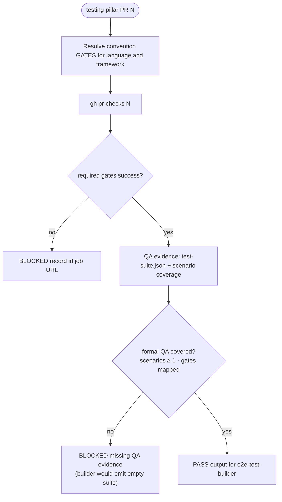
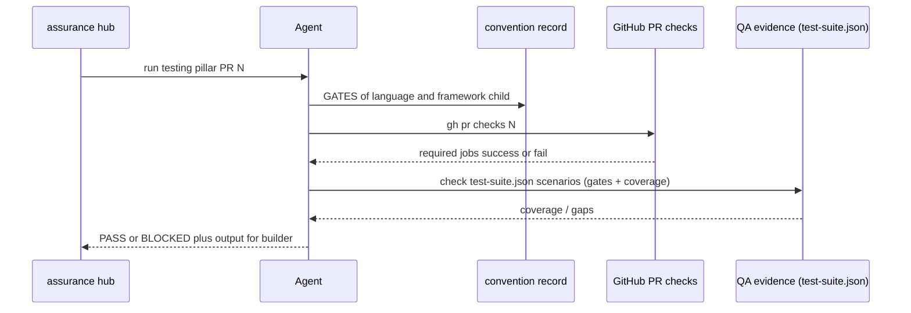

# testing — PR triage sub-protocol

Parent hub: [`references/triage/protocol.md`](../triage/protocol.md).

OpenSpec contract (PR stage slice): `openspec/changes/add-assurance-toolkit/specs/toolkit/assurance-governance/spec.md`
→ requirement **Gates por etapa, rápidos primero** — PR row **`tests 100%`** only.
Security criticals and `coverage_delta` are **other pillars** (security + governance), not this file.

## Question

Does this PR have **testing evidence** that satisfies the convention record for this stack
(the **tests 100%** slice of the PR-stage gate)? This includes both the CI gates **and**
formal QA test evidence (scenario coverage / suite manifest) that the e2e-test-builder
would consume.

## Flow (PR stage — testing pillar only)

This pillar **does not** emit the PR receipt or evaluate `coverage_delta`; the hub runs
security and governance next. Aggregate **`/assurance:triage pr` PASS** matches the full
PR row in assurance-governance when all required pillars PASS.

## Sequence (agent ↔ CI)

## Steps

1. Resolve the convention record for this change:
   `shared/references/conventions/language/<id>/README.md` and, when the repo
   has a framework, `frameworks/<fw>.md`. Example: `php` + `laravel@0.1.0`
   (`vendor/bin/pint --test`, `php artisan test`, Architecture, PHPStan when
   the repo declares it).
2. Confirm PR checks cover those GATES (smoke subset on a branch push, full
   suite when the record's CI tier says so). Use `gh pr checks <N>`.
3. **QA evidence scan (formal QA):** locate `test-suite.json` (project root,
   `gherkin/`, `e2e/`, or `tests/e2e/`). Verify it is non-empty and that its
   `scenarios` list maps to the gates that ran — a suite with **0 scenarios**
   or **0 gates mapped** is insufficient (the e2e-test-builder would emit an
   empty suite). If no suite exists yet, that is a **BLOCKED missing-QA-evidence**
   condition **unless** the PR is purely infra/docs with no behavioral surface
   (waive in config with a user-visible reason).
4. **BLOCK** when a required gate is failing or missing for in-scope changes,
   or when formal QA evidence is absent for a behavioral change. The report names
   the record id, the gate, the check URL, and the QA evidence state.
5. **PASS** when those gates are success (or explicitly waived in config with
   a user-visible reason) **and** formal QA coverage is present. The PASS output
   is the input of [`/assurance:e2e-test-builder`](../../commands/e2e-test-builder.md):
   record id, gates that ran, QA scenario coverage, and any scenario gaps.
   Ready-to-review invokes the builder **after** aggregate §2b PASS and **before**
   remote review (§2c).

## Out of scope

- [`/assurance:e2e-test-runner`](../../commands/e2e-test-runner.md). That command
  belongs to the stage QA assignee, after the issue is **In Review** and
  assigned to them. Secrets: Darío Monestel, see
  [QA ready (stage)](https://linear.app/hyperlabllc/view/caa6a7d1-d599-4776-b206-4d935268a9d2).
- [`/assurance:e2e-test-preview`](../../commands/e2e-test-preview.md) — visual
  inspection, not a gate.
- `coverage_delta` and PR receipt (governance pillar).
- Critical security findings (security pillar).
- Release-only perf/load gates (see governance release stage).
- Mixing security scanner output into the testing verdict.
