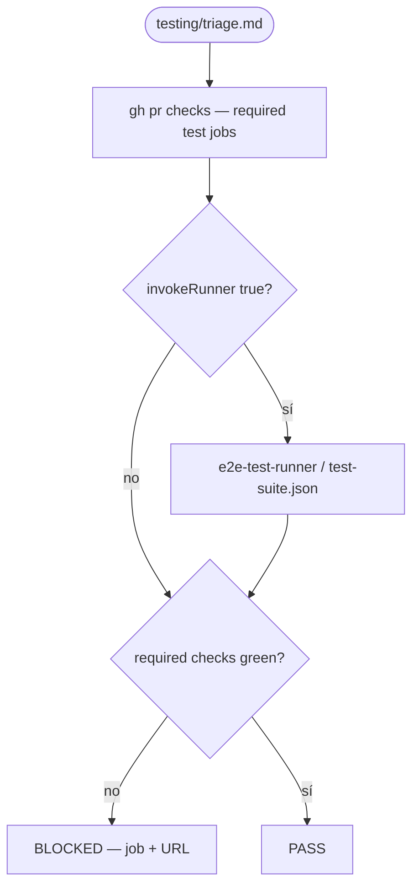
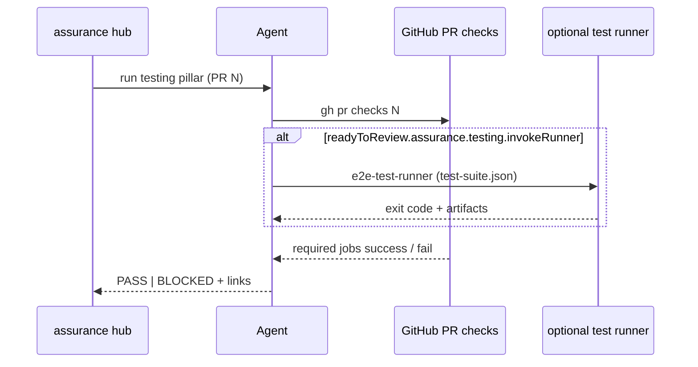

# testing — PR triage sub-protocol

Parent hub: [`references/triage/protocol.md`](../triage/protocol.md).

## Question

Does this PR have **testing evidence** that satisfies the PR-stage gate?

## Flow (PR stage)

## Sequence (agent ↔ CI)

## Steps

1. Confirm PR checks include required test jobs for this repo (unit/integration/E2E
   as configured in CI). Use `gh pr checks <N> --watch` or latest completed runs.
2. If the repo defines an assurance testing runner (e.g. `e2e-test-runner` against
   `test-suite.json`), run it only when `readyToReview.assurance.testing.invokeRunner`
   is true; otherwise CI green is sufficient.
3. **BLOCK** when any **required** test check is failing or missing for in-scope
   changes.
4. **PASS** when all required test checks are success (or explicitly waived in
   config with user-visible reason — never silent).

## Out of scope

- Release-only perf/load gates (see governance release stage).
- Mixing security scanner output into the testing verdict.
