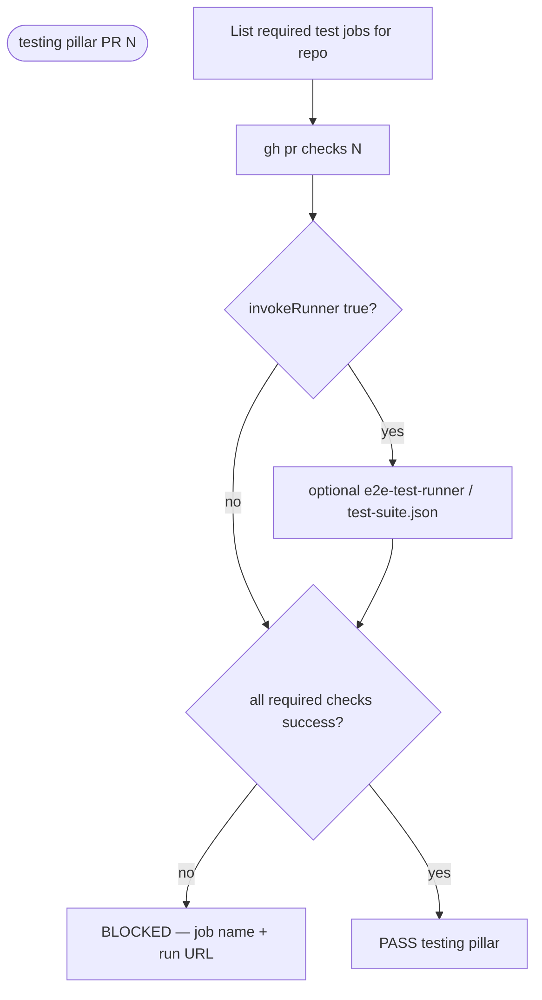
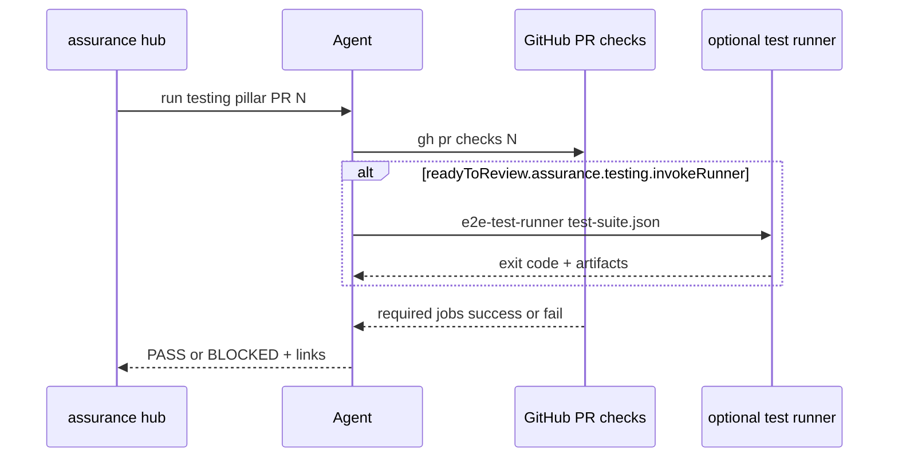

# testing — PR triage sub-protocol

Parent hub: [`references/triage/protocol.md`](../triage/protocol.md).

OpenSpec contract (PR stage slice): `openspec/changes/add-assurance-toolkit/specs/toolkit/assurance-governance/spec.md`
→ requirement **Gates por etapa, rápidos primero** — PR row **`tests 100%`** only.
Security criticals and `coverage_delta` are **other pillars** (security + governance), not this file.

## Question

Does this PR have **required test CI evidence** for the head SHA (interpreted as the
**tests 100%** slice of the PR-stage gate)?

## Flow (PR stage — testing pillar only)

This pillar **does not** emit the PR receipt or evaluate `coverage_delta`; the hub runs
security and governance next. Aggregate **`/assurance:triage pr` PASS** matches the full
PR row in assurance-governance when all required pillars PASS.

## Sequence (agent ↔ CI)

## Steps

1. Confirm PR checks include required test jobs for this repo (unit/integration/E2E
   as configured in CI). Use `gh pr checks <N> --watch` or latest completed runs.
2. If the repo defines an assurance testing runner (e.g. `e2e-test-runner` against
   `test-suite.json`), run it only when `readyToReview.assurance.testing.invokeRunner`
   is true; optional runner failure **BLOCKS** even when other checks are green.
3. **BLOCK** when any **required** test check is failing, pending beyond policy, or
   missing for in-scope changes.
4. **PASS** when all required test checks are success (or explicitly waived in
   config with user-visible reason — never silent).

## Out of scope

- `coverage_delta` and PR receipt (governance pillar).
- Critical security findings (security pillar).
- Release-only perf/load gates (see governance release stage).
- Mixing security scanner output into the testing verdict.
