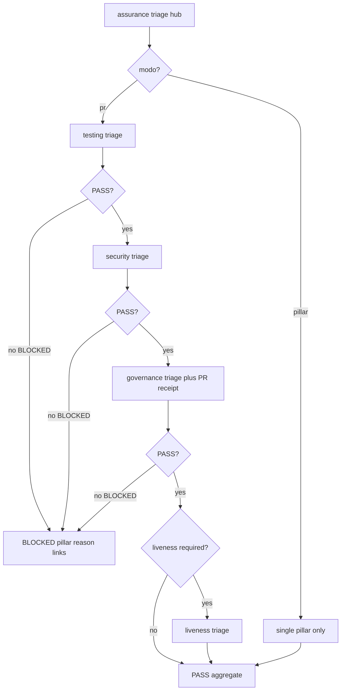
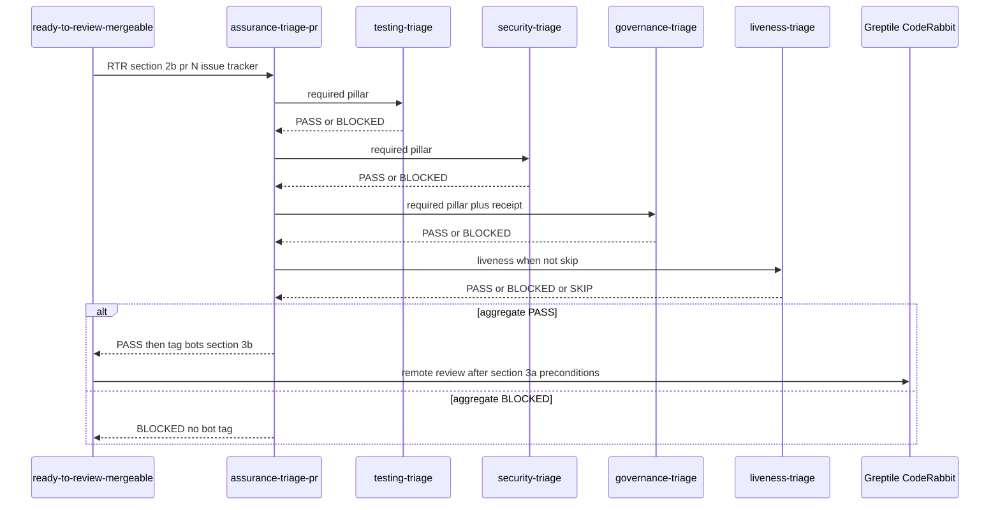

# /assurance:triage — protocol SSOT (hub)

Harness-agnostic router. Thin entry: `commands/triage.md`.

assurance writes **evidence**; dev workflows consume it in **gates**. `/assurance:triage`
classifies PR-stage evidence **per pillar** and returns a single verdict before
code-review bots run.

---

## Invocation

```text
/assurance:triage [pr|testing|security|liveness|governance] [--pr N] [--issue TEAM-N] [$ARGUMENTS...]
```

| Mode | When | Runs |
| --- | --- | --- |
| **`pr`** (default) | Ready-to-review / PR gate | Every pillar marked `required` or `optional` for stage `pr` in config; skips `skip`. |
| **`<pillar>`** | Deep dive on one pillar | That pillar's sub-protocol only. |

**Liveness on PR:** default is **SKIP** — not “forgotten”. SSOT:
`readyToReview.assurance.pillars.liveness: "skip"` (observability cadence is schedule/daemon,
not per-PR). Set `required` only when the consumer repo opts in.

Resolve PR number from `--pr N`, else `gh pr view` for the current branch.

---

## Sub-protocols (SSOT)

| Pillar | Sub-protocol | Typical PR stage |
| --- | --- | --- |
| testing | [`references/testing/triage.md`](../testing/triage.md) | `required` |
| security | [`references/security/triage.md`](../security/triage.md) | `required` |
| liveness | [`references/liveness/triage.md`](../liveness/triage.md) | `skip` (default) |
| governance | [`references/governance/triage.md`](../governance/triage.md) | `required` |

Run sub-protocols **in order**: testing → security → governance → liveness (only if
not `skip`). Stop on first `BLOCKED` unless config sets `continueOnOptionalFailure`.



## Sequence (RTR §2b — before remote bots)



---

## Verdict contract

Each sub-protocol returns:

```text
PASS | BLOCKED | SKIP
```

Hub aggregate:

- **PASS** — all non-skipped pillars PASS.
- **BLOCKED** — at least one required pillar BLOCKED; include pillar id + reason +
  links (CI run, scanner, receipt path).
- **SKIP** — entire hub skipped (e.g. assurance plugin absent and config allows).

Write a PR-stage receipt when `governance` sub-protocol requires it (see
`references/governance/triage.md`).

---

## Configuration

Consumer repo optional keys:

- `make-no-mistakes.config.json` → `readyToReview.assurance`
- or `assurance.config.json` at repo root (same shape)

See `toolkits/make-no-mistakes-toolkit/commands/make-no-mistakes.config.example.json`.

---

## LESSONS (hub)

- L1 (assurance `protocol.md` GitHub Mermaid render failure) Flowcharts on github.com
  break when edge labels use `:` (e.g. `|no: BLOCKED|`), node text embeds `/` or
  `§`, or accents in unquoted nodes; sequence diagrams break when `opt` nests
  inside `alt` without closing. Dogfood profile:
  `platform/diagrams/mermaid-github` (change `add-conventions-platform-docs-diagrams`).

---

## Relationship to other commands

- **`/assurance:triage-security-findings`** — security pillar implementation for
  backlog triage; invoked **from** `references/security/triage.md` when needed.
- **`/ready-to-review-mergeable`** — calls this hub at **§2b** before **§3b**
  execute remote PR review (§3c gate green before §5 handoff).
