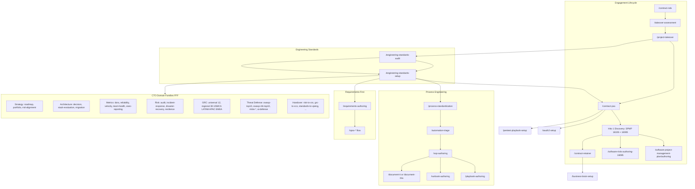

# Engagement orchestration

Full command/skill chain for a fractional CTO engagement. Linked from the
toolkit [README](../README.md). Keep node labels free of bare parentheses and
`/` inside unquoted Mermaid text so GitHub can render the diagram.

## Project governance note

`/contract-psa` makes SPMP + ISO/IEC/IEEE 16085 **Milestone 1 Discovery** on the
standard path. Preventa ships `*-bare.md` outlines only. After signature, invoke
`/software-project-management-plan/authoring` and `/software-risks-authoring-16085`
to fill them. Org GRC stays `/iso31000`.
