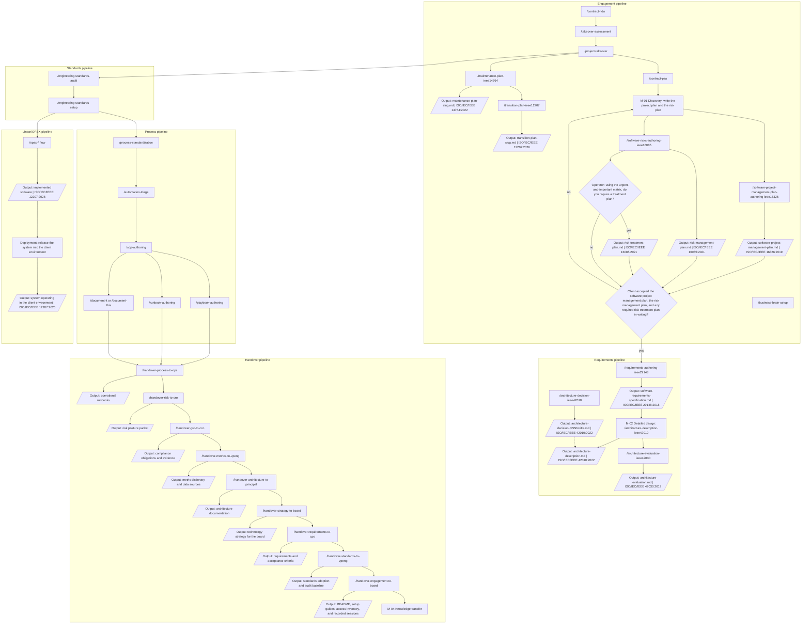

# Engagement orchestration

Full command/skill chain for a fractional CTO engagement. Linked from the
toolkit [README](../README.md). Keep node labels free of bare parentheses and
`/` inside unquoted Mermaid text so GitHub can render the diagram.

Rectangles are processes. Diamonds are yes/no decisions. Parallelograms are outputs, and each output names its standard. The diagram names for the project plan and the risk plan are the standard names. The files on disk stay `plans/<fecha>-plan-proyecto-<slug>.md` and `plans/<fecha>-gestion-riesgos-16085.md`.

## Project governance note

`/contract-psa` section 7.2 fixes M-01 and M-04. M-01 writes the project plan and the risk plan. A diamond asks whether the operator, using the urgent-and-important matrix, requires a treatment plan. A second diamond asks whether the client accepted the software project management plan, the risk management plan, and any required risk treatment plan in writing. No sends the plans back to M-01. Yes is the only exit that invokes `/requirements-authoring-ieee29148`. That pipeline writes the architecture description, and `/architecture-description-ieee42010` invokes `/architecture-evaluation-ieee42030` when M-02 evaluates. After the takeover questionnaire, `/project-takeover` invokes `/maintenance-plan-ieee14764` and then `/transition-plan-ieee12207`. The requirements pipeline does not start `/opsx-*`. `/engineering-standards-setup` does. From there the Linear/OPSX pipeline implements the software and deployment releases it into the client environment. That release does not start M-04.

M-04 is the last step of the Handover pipeline. Each handover command emits its own output. `/handover-process-to-ops` emits the operational runbooks. `/handover-architecture-to-principal` emits the architecture documentation. `/handover-engagement-to-board` emits the README, the setup guides, the access inventory, and the recorded sessions. M-04 is reached from that close.

`/business-brain-setup` is part of the engagement pipeline. It creates the vault for that engagement. The process skills write into `_procedimientos/` when that folder already exists.

`/engineering-standards-setup` does not invoke `/requirements-authoring-ieee29148`. Its own scaffold flowchart ends at the commit. In this orchestration it is the command that starts `/opsx-*`. `/contract-psa` invokes `/requirements-authoring-ieee29148` on the yes branch of the acceptance diamond.

M-01 outputs are the 16326 plan, the 16085 plan, and the 16085 treatment only when the operator requires it. Preventa ships `*-bare.md` outlines only. After signature, invoke `/software-project-management-plan-authoring-ieee16326` and `/software-risks-authoring-ieee16085` to fill them. Org GRC stays `/iso31000`.
