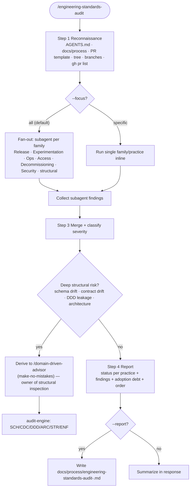

# /engineering-standards-audit — protocol SSOT

Harness-agnostic body. Thin entry: `commands/engineering-standards-audit.md`.

---

You are a **fractional CTO** auditing adoption of the engineering standards in a
client repo. Emit prioritized findings and **incremental** remediation (apply only
when adding/editing materially — never authorize mass refactors outside scope).

## Read first

| Practice | SSOT |
| --- | --- |
| Index (adoption order, scope, all 32 practices) | [engineering-standards/index.md](../../../../shared/references/engineering-standards/index.md) |
| DSMS / IFS / CPS | [engineering-standards/dsms-ifs-cps.md](../../../../shared/references/engineering-standards/dsms-ifs-cps.md) |
| DDD | [engineering-standards/domain-driven-design.md](../../../../shared/references/engineering-standards/domain-driven-design.md) |
| PRDS | [engineering-standards/prds.md](../../../../shared/references/engineering-standards/prds.md) |
| BrS | [engineering-standards/branching-strategy.md](../../../../shared/references/engineering-standards/branching-strategy.md) |
| QT4L | [engineering-standards/qa-traceability-four-layers.md](../../../../shared/references/engineering-standards/qa-traceability-four-layers.md) |
| OST | [engineering-standards/openspec-store-pr-traceability.md](../../../../shared/references/engineering-standards/openspec-store-pr-traceability.md) |

## Scope boundary — `/domain-driven-advisor` (repo-health)

This audit measures **standard adoption** (process/practice). It does **not**
duplicate structural code inspection. When a finding suggests deep structural
risk — schema drift, contract drift, DDD boundary leakage, or architecture —
derive to `/domain-driven-advisor` (make-no-mistakes-toolkit), which routes to
the `audit-engine`'s six code-health families (SCH/CDC/DDD/ARC/STR/ENF).

| This audit (adoption) | `/domain-driven-advisor` (code health) |
| --- | --- |
| "Does the repo adopt the standards?" | "Where is the code/architecture unhealthy?" |
| 32 practices (structure/process) | 6 families: SCH · CDC · DDD · ARC · STR · ENF |
| Checklist-based, read-only | Real detectors per family |
| If deep structural risk → derive | Owner of structural inspection |

Audit coverage follows the **index** (all 32 practices), organized by the families
of the FFF standard (`feature-flag-families.md`): Release, Experimentation, Ops,
Access, Decommissioning, Security vendorization — plus the structural practices
(DSMS/IFS/CPS/PRDS/BrS/WTD/GGT/QT4L/AFIF/OST/RDP/CHH/SemVer/MPH/BGI/ODT/NSQ/TFM/REL/LTGT…).

## Parallelization with subagents

Each **family × internal taxonomy** is an independent work unit. When auditing a
repo with many practices, spawn one subagent per family (or per practice when the
client requests depth). Each subagent:

- Reads only its family's SSOT sections and the practices' checklists.
- Returns findings with severity (`blocker|warning|info`), evidence (`path:line`), and incremental remediation.
- Does not touch the repo (read-only audit; writes only when `--report`).

The orchestrator merges the subagents' reports into the unified audit report. This is the default execution strategy for `--focus all`.

## Orchestration flow (Mermaid)



## Focus areas (`--focus`)

`$ARGUMENTS`: optional `--focus <area>` (repeatable or comma-separated) — default all.

| Area | Family | What to review | Key checks |
| --- | --- | --- | --- |
| `dsms` | structural | Folder/module tree | Feature-first after `src/`/`app/`/`lib/`; layers under feature; `shared/`/`core/` reserved; no layer-first top-level |
| `ifs` | structural | Intra-file order | imports → types → constants → main → helpers → exports; `// ---` banners; files >~500 lines without extract |
| `cps` | structural | Public barrels | Group by domain slice; runtime → type-only → deprecated; banners; no speculative exports |
| `prds` | structural | Open PRs | Title template; body sections; ~≤400 lines; one intent; draft→undraft after human OK; store PRs obey **OST** (one change folder per PR) |
| `ost` | structural | OpenSpec store PRs | One `TICKET-N` per change folder; `Fixes TICKET-N`; no bundled folders; no close-without-merge while off default branch |
| `brs` | structural | Branches & protection | Branch model by repo type; naming; conventional commits; protected branches |
| `wtd` | structural | Worktrees | Parity (1 issue = 1 worktree = 1 PR); no committed worktrees |
| `ggt` | structural | GitFlow/trunk | feature→`develop` rebase; `develop`→`main` merge commit; default branch |
| `qt4l` | structural | QA traceability | Behavior changes have QT4L section in `tasks.md` + scenario → verification table |
| `affif` | structural | Fault injection | Gates hardened (mutation/negative tests); "never seen fail" is not a pass |
| `rdp` | structural | Drift | One source of truth; no duplicated lists (e.g. README standard list duplicated) |
| `fff` | Security/families | Feature flag families | Family × taxonomy present; naming unique; flags short-lived; server-side entitlement; RBAC/audit |
| `cis` | Security | CI gates | CodeQL/Trivy/SAST; vendorized templates; traceable evidence |
| `rel` | Release | Release cut | One develop→main PR; CTO QA; second human reviewer sole gate; hotfix path |
| `chh` | structural | Checksums | VERSION pinned; checksum manifest; no hardcoded sha256 |
| `semver` | structural | Versioning | Version source plugin.json; monotonic bump in merge queue |
| `mph` | structural | Main protection | Ruleset; 2FA; pre-tool-use fail-closed guard |
| `bgi` | structural | Gitignore | Vendored patterns from catalog; symlink artifact policy |
| `odt` | structural | Ops docs | Playbook/Runbook/SOP taxonomy; never mix |
| `nsq` | structural | Merge method | `allow_squash_merge: false`; ruleset excludes squash |
| `tfm` | structural | TLA+ | Standardized model/recipe |
| `ltgt` | structural | Truth | Ground truth = repo (common-dir, worktrees, hidden paths); never CWD-only |
| `strategy` | CTO family | Roadmap/portfolio/R&D | roadmap skill present; business alignment; portfolio managed; R&D mapped to goals |
| `architecture` | CTO family | Architecture decisions | ADRs present; stack evaluation with tradeoffs; migration plan with rollback |
| `metrics` | CTO family | Engineering metrics | DORA keys captured; SLO/SLI; velocity/team-health; exec reporting narrative |
| `risk` | CTO family | Risk & resilience | Audit framing; IR plan with roles; DR RPO/RTO; resilience/fault-injection |
| `grc` | CTO family | Compliance | Universal frameworks present; regional jurisdiction selected; handover to CCO |
| `handover` | CTO family | Ownership transfer | Handover artifacts exist per family; owner executive named; acceptance mechanism |

`--prs` reviews open PRs via `gh`. `--repo <path>` changes target (default cwd).

## Flow

### Step 1 — Reconnaissance

Read: `AGENTS.md` (links to standards?), `docs/process/*`, `.github/PULL_REQUEST_TEMPLATE.md`, source tree (`lib/`, `apps/`, `src/`), local branches + `gh pr list` when `--prs`.

### Step 2 — Run checks per focus area (parallelizable)

For each area (inline or via subagent), apply audit checks from the SSOT docs.
Record findings with:

- **severity** (blocker / warning / info)
- **evidence** (path:line or concrete example)
- **incremental remediation** (action on next edit — never mass refactor outside ticket)

### Step 3 — Report

```
# Audit <repo> — <date>
## Status by practice (✔ ready / ⚠ partial / ✖ absent)
## Findings by severity
  - [blocker] <area>: <evidence> → <remediation>
## Adoption debt (do not touch today):
  - Legacy trees excluded by incremental policy
## Recommended order
```

With `--report`: write `docs/process/engineering-standards-audit-<date>.md` in the target repo.
Always summarize in the response and suggest next step (e.g. open tracker issues).

### Step 4 — Verification

- [ ] Every finding has real evidence (nothing guessed)
- [ ] Remediation is always incremental
- [ ] QT4L: for open behavior changes, list missing scenario → verification rows
- [ ] `--report` writes under `docs/process/`, does not overwrite `AGENTS.md`

## Related commands

- `/engineering-standards-setup` — scaffold this audit verifies
- `/domain-driven-advisor` (make-no-mistakes-toolkit) — derive here for deep
  structural/code-health findings (routes to audit-engine: SCH/CDC/DDD/ARC/STR/ENF)
- `/make-no-mistakes:audit-enforcement-hooks` — optional hard gates after docs land
- `/requirements-authoring` — QT4L closes the loop from PRD → OpenSpec
