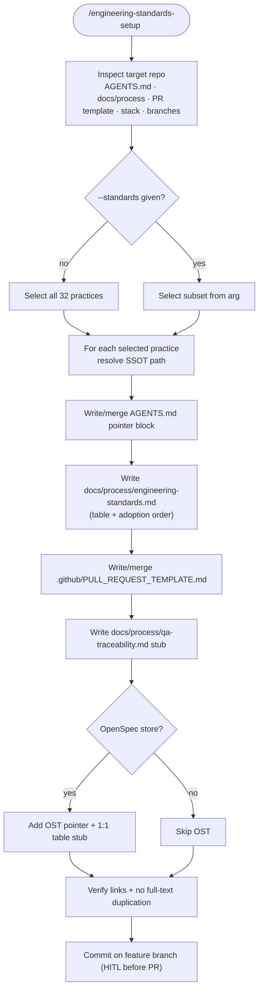

# /engineering-standards-setup — protocol SSOT

Harness-agnostic body. Thin entry: `commands/engineering-standards-setup.md`.

---

You are a **fractional CTO** preparing a client's engineering baseline. Output is
the **scaffold** that makes the engineering standards enforceable from day one by
**linking** to SSOT references — never duplicating full protocol text in the
client repo.

## Read first

| Practice | SSOT |
| --- | --- |
| Index (adoption order, scope, all 32 practices) | [engineering-standards/index.md](../../../../shared/references/engineering-standards/index.md) |
| DSMS / IFS / CPS | [engineering-standards/dsms-ifs-cps.md](../../../../shared/references/engineering-standards/dsms-ifs-cps.md) |
| DDD | [engineering-standards/domain-driven-design.md](../../../../shared/references/engineering-standards/domain-driven-design.md) |
| PRDS | [engineering-standards/prds.md](../../../../shared/references/engineering-standards/prds.md) |
| BrS | [engineering-standards/branching-strategy.md](../../../../shared/references/engineering-standards/branching-strategy.md) |
| QT4L | [engineering-standards/qa-traceability-four-layers.md](../../../../shared/references/engineering-standards/qa-traceability-four-layers.md) |
| OST | [engineering-standards/openspec-store-pr-traceability.md](../../../../shared/references/engineering-standards/openspec-store-pr-traceability.md) |

All **32 practices** are scaffoldable: each practice gets a pointer in the client
`AGENTS.md` / `docs/process/engineering-standards.md` (see default outputs). The
index is the single source of truth for scope and adoption order.

## Default outputs (in target `<repo>/`)

- `AGENTS.md` — pointer block: **all requested standards** (default: all 32) + PR template + QA traceability; rule "read before opening a PR".
- `docs/process/engineering-standards.md` — local index (table of the requested practices + adoption order) linking to toolkit SSOT paths or vendored copies.
- `.github/PULL_REQUEST_TEMPLATE.md` — PRDS template ([prds.md](../../../../shared/references/engineering-standards/prds.md)).
- `docs/process/qa-traceability.md` — QT4L mini-guide: when the `tasks.md` section is mandatory + scenario → verification table stub.
- When the client uses an OpenSpec **store** repo: add OST pointer + 1:1 table stub linking `TICKET-N` → change folder → store PR ([openspec-store-pr-traceability.md](../../../../shared/references/engineering-standards/openspec-store-pr-traceability.md)).

Optional with `--branching`: `docs/process/branching.md` from BrS.

`--standards dsms,ddd,ifs,cps,ccc,clh,cvc,clg,pch,prds,brs,wtd,jidoka,sts,ggt,qt4l,afif,ost,rdp,chh,semver,mph,bgi,odt,nsq,tfm,cis,rel,fff,ltgt,no-deprecated-agent-shims,codeowners-replication`
restricts subset; default all 32.
`--dry-run`: report only, no writes.

## Orchestration flow (Mermaid)

## Flow

### Step 1 — Inspect target repo

- Existing `AGENTS.md`? Merge pointers; do not duplicate.
- Existing PR template? Merge sections; do not silently drop client fields.
- Stack (TS/Dart/PHP/K8s)? Note suggested DSMS tree in the index.
- Branches? Document current state in branching doc when `--branching`.

### Step 2 — Generate scaffold

1. Write/merge `AGENTS.md` pointer block (exact SSOT paths for each selected practice).
2. Create `docs/process/engineering-standards.md` with the practices table + adoption order.
3. Create/merge `.github/PULL_REQUEST_TEMPLATE.md` from PRDS template.
4. Create `docs/process/qa-traceability.md` with QT4L stub.
5. (`--branching`) Write `docs/process/branching.md`.

### Step 3 — Verify and deliver

- [ ] `AGENTS.md` links are verifiable — no full-text duplication
- [ ] PR template has all PRDS sections
- [ ] QT4L stub ready for behavior-change `tasks.md`
- [ ] `--dry-run` produced no writes
- [ ] If client repo is git: commit on feature branch; **HITL** before `gh pr create --draft`

Close by recommending **`/engineering-standards-audit`** on the same repo to verify adoption, and QT4L sections on any open behavior changes.

## Related commands

- `/engineering-standards-audit` — verify scaffold + measure adoption (per family, parallelizable with subagents)
- `/make-no-mistakes:audit-enforcement-hooks` — optional structural gates
- `/requirements-authoring` — PRD → OpenSpec pipeline; QT4L closes the QA loop
