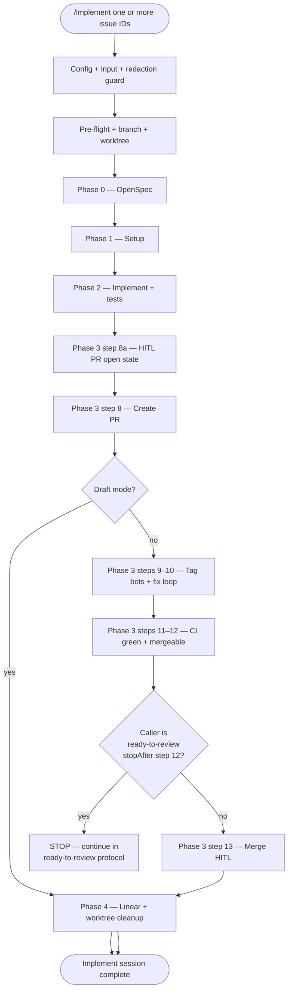
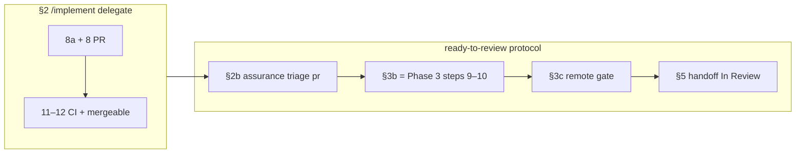

# /implement — Disciplined Execution Protocol

Senior engineering lead protocol for Linear issues: worktree isolation, parallel sub-agents, reviewer loops, CI, clean merges.

**Harness-agnostic SSOT:** read and follow the files below **in order**. Do not skip phases. Behavior is unchanged from the pre-split protocol — only structure moved to `references/implement/`.

## Pipeline overview (default `/implement`)

Phase 3 is where remote bot review and CI live. **Steps 9–10 are not duplicated** when you use `/ready-to-review-mergeable` — that command **skips** them during implement and runs the **same** steps once later as protocol **§3b** (after assurance **§2b**). See the split diagram below.

**Draft mode:** after step 8, jump to Phase 4 HITL gates (steps 14–15); steps 9–13 are skipped. See `references/implement/phase-3-pr-review.md`.

## Split with `/ready-to-review-mergeable` (not duplicate work)

Normative order for the combined command lives in
`references/ready-to-review-mergeable/protocol.md`. This diagram shows **who runs which Phase 3 slice** so steps 9–10 are not executed twice.

| Phase 3 step | Full `/implement` | `/ready-to-review-mergeable` |
| --- | --- | --- |
| 8a–8, 11–12 | Yes — open PR, CI, conflicts | Yes — implement **stops after 12** |
| 9–10 | Yes — tag bots + fix loop | **No here** — run once as **§3b** after **§2b** |
| 13–15 | Merge + Linear + worktree (mode-gated) | **Out of scope** — never merge from RTR |

Config key: `make-no-mistakes.config.json` → `readyToReview.implement.stopAfter` (default `phase-3-step-12`).

## Reference index (read in order)

| Step | File |
|------|------|
| Parallel execution (multi-issue) | `references/implement/parallel-execution.md` |
| Specialized subagents | `references/implement/specialized-subagents.md` |
| Config + input | `references/implement/config-and-input.md` |
| Redaction guard (Bilingual) | `references/implement/redaction-guard.md` |
| Pre-flight | `references/implement/preflight.md` |
| Branch + worktree | `references/implement/branch-and-worktree.md` |
| HITL boundaries | `references/implement/hitl-boundaries.md` |
| Phase 0 — OpenSpec | `references/implement/phase-0-openspec.md` |
| Phase 1 — Setup | `references/implement/phase-1-setup.md` |
| Phase 2 — Implement | `references/implement/phase-2-implement.md` |
| Phase 3 — PR + review | `references/implement/phase-3-pr-review.md` |
| Phase 4 — Merge + cleanup | `references/implement/phase-4-merge-cleanup.md` |
| Chain merge | `references/implement/chain-merge.md` |
| Anti-patterns + checklist + Slack | `references/implement/anti-patterns-and-checklist.md` |

Multi-harness entry matrix: `references/implement/adapters/README.md`.

`$ARGUMENTS` = one or more Linear issue IDs or URLs.
