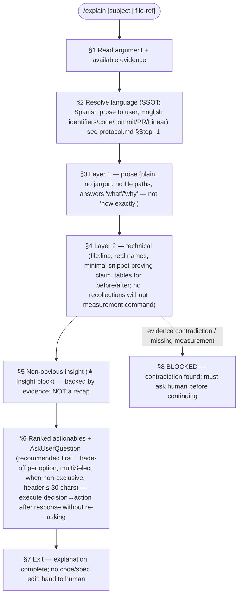

# /explain — protocol SSOT

Harness-agnostic body. Thin entry: `commands/explain.md`.

---

# /explain: $ARGUMENTS

**Two-layer explanation protocol — prose first, technical second, non-obvious insight + ranked actionables.**

**Exit means:** the explanation is complete — layer 1 (plain prose, understandable by a non-technical human), layer 2 (technical evidence referencing code/protocol/artifact paths with `file:line` and measured results, not recollections), one non-obvious insight backed by evidence, ranked actionables (each with what it does, what it costs — time, risk, impact radius — and what remains unresolved), and an `AskUserQuestion` (Claude `/explain` uses `AskUserQuestion`; Cursor uses `AskQuestion`; OpenCode uses `AskQuestion`) to confirm direction. It does **not** mean code changed, specs edited, or PR merged.

The user input can be provided directly or as a command argument — you MUST consider it before proceeding.

---

## Prerequisites

### Subject token (mandatory)

- `$ARGUMENTS` MUST include a description of what to explain (e.g., "why the poller fails", "src/lib/ratchet.ts").
- If empty: explain the last thing discussed in the session; never invent a technical subject.

### Evidence available (optional — read BEFORE writing)

Read relevant evidence files when present (per SSOT anti-pattern: "No explanation without verification"):

- `references/ready-to-review-mergeable/*.md` — protocol/state artifacts.
- `postmortem-*.md` — 5-why chain evidence (see `systematic-debugging/SKILL.md`).
- `catalog-evidence.md` — feature/tool catalog verification results.
- Source files referenced in `$ARGUMENTS` — read before explaining (not working tree; read the `ref` — commit/branch reference).
- `references/ready-to-review-mergeable/protocol.md` — protocol invariant reference.

If verification is impossible: state `"this was not verified"` at the point where evidence would go — that statement is part of the explanation, not a failure of it.

---

## Pipeline overview

**Invariant:** exit = complete explanation handed to human — prose layer verified understandable; technical layer references verified; insight backed; actionables ranked; no hidden redirects (`2>/dev/null`, `>/dev/null`, `2>&1` forbidden per harness `stderr/README.md`); protocol files in English (SSOT `docs/hitl.md`); anti-boilerplate / anti-mojibake.



---

## §1 Read argument + available evidence

- If `$ARGUMENTS` references a file/path: read that file (or the minimal relevant section) before writing layer 2.
- If a `postmortem-*.md` or `catalog-evidence.md` exists in `references/ready-to-review-mergeable/`: reference it in layer 2.
- If no verification possible: state explicitly (`"this was not verified"`) at the point where evidence would be cited — that is part of the explanation, not a failure.

---

## §2 Resolve language (SSOT — see `docs/hitl.md`)

Read `make-no-mistakes.config.json` at repo root (see `make-no-mistakes.config.example.json`). If it exists, use its `language`; otherwise default to **English** for all protocol files (per harness SSOT: `docs/hitl.md` — protocol files in English; anti-mojibake; anti-boilerplate; no hidden redirects).

The language governs **only the prose layer** (layer 1, this protocol file). Identifiers, code, commit messages, PR titles/bodies, and Linear issue titles follow the destination repo's convention (typically English). A command that writes in GitHub or Linear does not translate that output based on this key.

---

## §3 Layer 1 — prose (plain, understandable to non-technical human)

Zero jargon; zero file paths; zero function names. 2–5 sentences.

**The rule deciding value:** prose is NOT the technical layer with simpler words. It answers a **different question**: prose answers `"what is happening and why does it matter"`; technical answers `"where exactly and how"`. If your prose paragraph is a summary of the technical block, delete it — it is redundant and readers skip it, which is how these explanations become useless.

Quick test: if a person who does not touch this codebase can repeat your prose and make a correct decision with it, it passes.

---

## §4 Layer 2 — technical evidence (verified against code/protocol/artifacts)

Now: paths with `file:line`, real names, minimal snippet proving the claim, tables for before/after or comparison.

Cite what you **measured**, not what you remember. A number without the command that produced it is an opinion with data formatting.

Reference concrete artifacts:
- Source files (`.ts` / `.py` / `.sh`) with line references.
- Protocol artifacts (`references/ready-to-review-mergeable/protocol.md`, `catalog-evidence.md`, `postmortem-*.md`).
- Command definitions (`commands/*.md`) when explaining command behavior.
- Skill references (`systematic-debugging`, `brainstorming-visual-companion`) when relating to methodology.
- Harness/runtime rules (`docs/hitl.md`, `AGENTS.md`) when explaining why a restriction applies.

---

## §4.5 ASD-STE100 output discipline (before emitting either layer)

The explanation output SHALL follow ASD-STE100 controlled-language discipline (simplified technical English), because both layers are consumed by a human AND by downstream agents — misreading has a cost. Based on `github.com/danyuchn/asd-ste100-skill` (structural rules fully; lexical rules as a direction of travel).

**Structural rules — apply (both layers):**
- Active voice: "The agent deletes the file." not "The file is deleted."
- No phrasal verbs: "start", not "spin up"; "remove", not "take off".
- One instruction per sentence; no semicolons; noun clusters ≤3 words.
- Sentence length ≤25 words (descriptions), ≤20 (instructions).
- No ellipsis: keep subject/verb explicit.
- **Keep modality**: never promote a hedge to a fact. "The request may have failed" stays as-is.

**Lexical rules — direction of travel:**
- One word, one meaning per document (don't rotate synonyms for the same thing).
- Prefer the verb over the noun form ("analyze" over "perform an analysis of").
- Define domain terms once if not common English.

**Scan checklist (run before emitting):**
1. Synonym rotation — pick one name, use it every time.
2. Hedge stacking — state the claim or delete it; never let qualifiers pile up until nothing is asserted.
3. Nominalization — use the verb.
4. Marketing adjectives (seamless, robust, powerful…) — delete or replace with the measurement.
5. Run-on sentences — one idea per sentence.
6. Soft phrasal verbs — use the single plain verb.

If a rewrite would drop necessary precision (a safety condition, a scope qualifier, a number), keep the longer phrasing and flag it — never silently simplify. Never add a fact the source did not state.

## §5 Non-obvious insight (`★ Insight` block)

```
★ Insight — <one line of context>
[2–3 bullet points, backed by evidence from §1/§3/§4]
```

**Earns its place only if it says something the reader could NOT derive from the two layers above.** Valid forms: an unexpected consequence, a reframing, a correction to an assumption made in the explanation itself, a hidden cost, or why the obvious fix is wrong.

If it recaps: **delete it**. A recap trains readers to skip the block, and then the block stops serving its purpose.

---

## §6 Ranked actionables + `AskUserQuestion`

Convert actionables into decisions, with the same contract as `/resolve-open-questions`:

- Up to **4 questions** per call.
- Recommended option **first**, labeled `(Recommended)`.
- `header` ≤ 30 chars.
- The **trade-off** in each `description` — not just the label.
- `multiSelect` when options are non-exclusive.

After user responses: emit `decision → action` per item and **execute without re-asking**. One approval = one action.

If no open decision remains (explanation was purely informational): say so in one line and **do NOT call `AskUserQuestion`**. A fabricated menu is worse than no menu.

---

## Anti-triggers (must NOT appear in output)

- **Active socratic investigation** — continuous prose, no headings.
- **Single-line question** (`"which port?"`) — answer and finish; don't wrap in 5 steps.
- **Execution plan** — that is `spec-recommend` or plan-approval flow, not `/explain`.
- **Session recap** — that is `/summarize`.
- No decorative `echo`; no hidden `2>/dev/null` / `>/dev/null` / `2>&1` in any example or script; no mixed-language option text (English for protocol; Spanish only when explicitly requested for user-facing prose — here: English per SSOT).
- No `TICKET-*` IDs for this repo's work (`#135` native GitHub Issues only; tracker reference is `Fixes #135` with canonical `https://github.com/chimeranext/better-toolkits/issues/135` URL).
- No claiming remote gate equals broken behavior (`postmortem-136-sync-check.md` distinguishes governance/version failure from behavioral regression).
- No proposing fixes before Phase 1 evidence (`systematic-debugging` Iron Law: `NO FIXES WITHOUT ROOT CAUSE INVESTIGATION FIRST`).
- No merging without HITL (`pre-push` guard `2e71a02`; protocol invariant: `READY FOR HUMAN REVIEW — NOT MERGE AUTHORIZED`).
