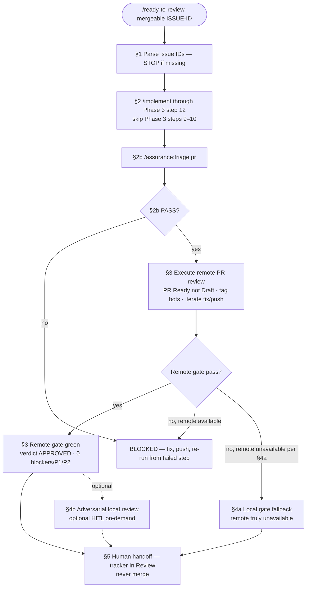

# /ready-to-review-mergeable — protocol SSOT

Harness-agnostic body. Thin entry: `commands/ready-to-review-mergeable.md`.

---

# /ready-to-review-mergeable: $ARGUMENTS

**One pipeline, one invariant: never merge.**

**Exit means:** the PR is **ready for human review** — remote automated review
has passed, CI is mergeable, the tracker issue is **In Review**, and a human
owns the next step on GitHub. This command does **not** mean the human already
approved, that the issue is **Done**, or that merge is authorized.

The user input can be provided directly by the agent or as a command argument —
you MUST consider it before proceeding.

---

## Prerequisites

### Tracker issue ID (mandatory)

- `$ARGUMENTS` MUST include at least one `<TEAM>-<number>` token (one PR per
  issue).
- If no issue ID is present: **STOP**. Tell the user to pass an issue ID or use
  a different command (e.g. branch-only CI repair is not this command).
- Do **not** infer issue IDs from branch names or PR bodies for this command.

### Configuration (optional)

Read `make-no-mistakes.config.json` at the repo root when present. See
`readyToReview` in `commands/make-no-mistakes.config.example.json`. Defaults
below apply when the block is absent.

| Key | Default | Meaning |
| --- | --- | --- |
| `readyToReview.remoteReview.required` | `true` | Remote bot review on the PR is mandatory before exit. |
| `readyToReview.localReview.mode` | `fallback-only` | Local diff review **satisfies the exit gate** only when remote cannot run (§4a). On-demand adversarial review (§4b) is separate HITL. |
| `readyToReview.implement.stopAfter` | `phase-3-step-12` | `/implement` stops before merge / Linear-Done / worktree cleanup. |
| `readyToReview.assurance.beforeRemoteReview` | `true` | Run `/assurance:triage pr` before tagging remote code-review bots. |
| `readyToReview.assurance.pillars.*` | testing/security/governance `required`, liveness `skip` | Per-pillar PR triage; see assurance `references/triage/protocol.md`. |

---

## Pipeline overview

**Invariant:** exit = **human review handoff** on GitHub — never merge, never Linear **Done**.

**Diagram note:** `Remote gate pass?` is **§3c** below. **`yes`** means the execute loop (§3b) already finished and the pass contract holds; then **`§3 Remote gate green`** is recorded before §5. It is not a shortcut that skips tagging bots.

**Assurance liveness on PR:** default pillar config is **`skip`** (`readyToReview.assurance.pillars.liveness: "skip"`) — observability runs on schedule/daemon, not every PR. Set `required` only when the consumer repo opts in.

### Normative order (whole command)

| Step | Section | Required before next |
| --- | --- | --- |
| 1 | §1 Parse issue IDs | At least one `<TEAM>-<number>` |
| 2 | §2 `/implement` → Phase 3 **step 12** only | PR exists, CI green, mergeable; **steps 9–10 not run here** |
| 3 | §2b `/assurance:triage pr` | **PASS** (or explicit config waiver) |
| 4 | §3 Remote review | **§3b execute** then **§3c gate** = **yes** when remote is available |
| 5 | §4a Gate fallback (local) | **Only** when §3c = `no, remote unavailable per §4a` |
| 5b | §4b On-demand adversarial review (optional HITL) | Anytime the **human** asks — **does not** replace §3 or §4a for exit |
| 6 | §5 Human handoff | §3 gate green **or** §4a documented fallback; never merge |

**Hard rule:** when remote review **can** run, exit requires §3b + §3c **`yes`**. A red remote gate (`no, remote available`) → **BLOCKED** in §3b — **do not** treat §4a or §4b as a bypass. **§4b is allowed** while remote is available; it is advisory / adversarial, not the automated gate.

### Mapping: `/implement` Phase 3 vs this command

| Phase 3 step | Default `/implement` | `/ready-to-review-mergeable` |
| --- | --- | --- |
| 8a–8, 11–12 | PR + CI + conflicts | §2 — implement stops at **12** |
| 9–10 | Tag remote bots + fix loop | **Deferred** — run as **§3b** after §2b PASS |
| 13–15 | Merge / Done / worktree | **Out of scope** — never from this command |

Implement-centric flow (same split, no duplicate steps 9–10):
`commands/implement.md` → **Pipeline overview** and **Split with `/ready-to-review-mergeable`**.

---

## Pipeline (always)

### 1. Parse arguments

- Issue IDs: every `<TEAM>-<number>` token in `$ARGUMENTS`.
- `--confidence X.X` if present: **advisory only** for reporting; the Stop hook
  gates on **findings**, not the Confidence float (see `stop-prs-green.sh`).
  Never silently raise a threshold the caller set.

### 2. Delegate implementation — `/make-no-mistakes:implement`

Invoke **`make-no-mistakes:implement`** for every parsed issue ID.

**Scope boundary:** implement runs through **Phase 3, step 12** (PR exists, not
Draft unless the user chose Draft at the PR open-state HITL gate, CI green,
no merge conflicts). **Skip implement Phase 3 steps 9–10** (remote bot tag /
wait loop) — those run in **§3** after **§2b** assurance triage. **Do not**
run implement Phase 4 (merge, Linear → Done, worktree removal) from this
command unless the user explicitly invoked full `/implement` in the same
session for merge.

Implement still owns:

- worktree isolation,
- PR open-state HITL (`Draft` / `In Review` / `Ready to Merge` — for this
  command prefer **In Review**; never choose **Ready to Merge** unless the user
  explicitly overrides in `$ARGUMENTS`),
- push and PR creation per repo rules.

See `references/implement/phase-3-pr-review.md` and
`references/implement/hitl-boundaries.md`.

### 2b. Assurance PR triage (mandatory before remote review)

When `readyToReview.assurance.beforeRemoteReview` is true (default):

1. Invoke **`/assurance:triage pr`** with `--pr <N>` and the tracker issue id
   (assurance plugin or thin harness entry pointing at
   `toolkits/assurance-toolkit/references/triage/protocol.md`).
2. Hub runs pillar sub-protocols in order (testing → security → governance →
   liveness only if not `skip`). See `readyToReview.assurance.pillars` in config.
3. **BLOCKED** → fix, push, re-run §2b; **do not** tag remote code-review bots.
4. **PASS** → proceed to §3.

If the assurance plugin is not installed and config does not set
`readyToReview.assurance.required: false`, run the same protocol body from the
monorepo reference path or report **BLOCKED** — do not skip silently.

Local diff review does **not** replace assurance triage or the **remote exit
gate** — except **§4a** when remote is unavailable. **§4b** never replaces §3.

### 3. Remote review (mandatory when available)

Applies when `readyToReview.remoteReview.required` is `true` (default). This
section is **three substeps** — match the diagram: **§3a → §3b → §3c**, then
**§3 gate green** on success.

#### 3a. Preconditions (before tagging bots)

- §2b assurance **PASS** (do not tag bots on BLOCKED assurance).
- PR is **Ready for review** (not Draft). If the user chose Draft at implement
  step 8a, flip to ready-for-review or **STOP** — do not skip §3 by jumping to §5.
- `.claude/.implement-prs` lists this PR (line 1: advisory `--confidence` if
  any; line 2+: PR URL or number) so `stop-prs-green.sh` can enforce green until
  handoff clears the file.

#### 3b. Execute remote review (always when remote is available)

This is **implement Phase 3 steps 9–10**, relocated here after assurance:

1. Tag remote reviewers per repo convention — e.g. comment `@greptile review`,
   and/or logins from `readyToReview.remoteReview.bots`, else
   `linear-setup.json` defaults (Greptile / CodeRabbit / Graphite when present).
2. Wait for configured bot verdicts; read **`.reviews[*]`**, never
   `.comments[*]` (mind `code-reviewer` vs `code-reviewer[bot]`).
3. On findings: fix → push → re-tag / re-poll until §3c passes or you hit
   `no, remote unavailable per §4a`.

Do **not** enter §5 without having run §3b at least once when GitHub remote
review is available.

#### 3c. Remote gate decision

After each §3b iteration, classify:

| Branch | When | Next |
| --- | --- | --- |
| **yes** | Remote pass contract below is satisfied | Record **§3 gate green** → proceed to **§5** |
| **no, remote available** | Contract not met; `gh`/bots still usable | **BLOCKED** — fix, push, repeat **§3b** (not §4a/§4b as bypass, not §5) |
| **no, remote unavailable per §4a** | Remote cannot be executed at all | **§4a** gate fallback → then **§5** |

**Remote pass contract** (align with `stop-prs-green.sh`):

- Latest verdict review from the configured reviewer login is **APPROVED**, and
- **0 blockers, 0 P1, 0 P2** in the parseable verdict headline.

Optional `--confidence` in the review body is **reported, not gated**.

**§3 gate green (checkpoint):** explicitly confirm the contract above for every
issue/PR, then continue. This is the diagram node between **`yes`** and §5 — it
documents that remote review **executed and passed**, not merely that assurance
passed.

When `readyToReview.remoteReview.required` is `false`, document the waiver in
the handoff table; §4a may become the exit gate only if config and user
visibility say so — never silently skip §3b when bots are available. §4b remains
optional HITL regardless.

### 4. Local diff review (two roles)

#### 4a. Gate fallback — remote code review unavailable

Use local review **only** to **satisfy the exit gate** when remote review cannot
be executed at all, for example:

- no GitHub bot configured and `gh` cannot post or read reviews,
- PR cannot be opened yet (user chose Draft and refuses to flip — then this
  command cannot complete; do not substitute §4a),
- harness has no remote integration and config documents `remote_unavailable`.

**Fallback order** (first runnable wins; record which ran):

1. Harness command from config `readyToReview.localReview.fallback[]` (e.g.
   `/local-pr-review`, `/review-bugbot`).
2. If none runnable: **BLOCKED** — report `remote_unavailable` and do not claim
   ready-to-review.

§4a does **not** apply when §3c is **`no, remote available`** (red bot gate) —
fix and repeat **§3b**; do not claim §5 via local fallback.

#### 4b. On-demand adversarial review (HITL)

When the **human** asks for deeper scrutiny (or the team routinely runs an extra
pass), invoke local tools such as `/local-pr-review` or `/review-bugbot`:

- **Allowed** while remote bots are available — this is **not** forbidden.
- **Human-in-the-loop:** run only on explicit user request or documented team
  ritual; surface findings in chat — do not auto-skip remote review.
- **Does not clear the exit gate** when `readyToReview.remoteReview.required`
  is true: §5 still requires **§3 gate green** (or §4a when remote is
  unavailable). Treat §4b output as **advisory / adversarial**, alongside bot
  verdicts in the handoff summary.

Optional diagram path: after **§3 gate green**, §4b may run before §5 when the
human wants it; it is never a substitute for a red remote gate.

### 5. Human handoff (exit)

**Entry condition:** for every issue, either **§3 gate green** (normal path) or
**§4a completed** with `remote_unavailable` documented. If remote was available
but the bot gate is red, you are still in §3b — **not** eligible for §5 (§4b
findings do not waive that).

You are **not done** until for every issue:

| Check | Required |
| --- | --- |
| Assurance PR triage | PASS per §2b (or explicitly waived in config) |
| Remote review | **§3b executed** and **§3c yes** / gate green, **or** §4a only when §3c = remote unavailable |
| Adversarial local (optional) | §4b if human asked — report in handoff; **not** a gate substitute |
| CI | All required PR checks green (or out-of-scope failures explicitly listed) |
| Mergeability | `mergeable` / no unresolved conflicts |
| Tracker | **In Review** (never **Done**) — verify MCP writes |
| Agent | Explicit handoff message: PR URL, remote verdict summary, **next action: human review on GitHub** |

Then:

1. Delete `.claude/.implement-prs` when the Stop hook would clear it (or delete
   explicitly after success).
2. Report one row per issue: **Issue → PR → remote verdict → tracker state**
   (`applied` vs `PENDING-MANUAL` on MCP no-ops).

**Never merge.**

---

## Deprecated: branch-only mode

Earlier revisions described a **branch-ready** path with no issue IDs. That path
is **removed**. Branch-only CI hygiene belongs in a separate maintenance command
or in `/implement` after an issue exists — not in `/ready-to-review-mergeable`.

---

## Out of scope (unless `$ARGUMENTS` says otherwise)

- Slack status posts
- Applying terraform / promoting environments
- Granting GitHub org/team ACL
- Marking tracker issues **Done**
- `gh pr merge`

---

## Anti-patterns

- Running this command without a tracker issue ID
- Tagging remote code-review bots before §2b assurance PASS
- Running implement Phase 3 steps 9–10 **before** §2b, or skipping §3b while bots work
- Jumping from assurance PASS (or from `Remote gate pass?` **no**) straight to §5
- Skipping §3b execute when GitHub bots are available
- Using **§4a** when §3c is `no, remote available` (red remote gate)
- Treating **§4b** adversarial output as satisfying `remoteReview.required`
- Using local review as the **exit gate** when remote works (§4a bypass)
- Claiming "ready for human" while remote is red or CI is failing in-scope
- Confusing bot APPROVED with human approval or merge permission
- Reading bot verdicts from `.comments[*]` instead of `.reviews[*]`
- Assuming a tracker MCP write applied without re-reading the issue
- Merging "just to unblock the next wave"
