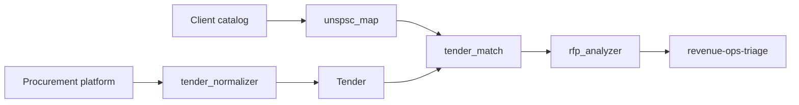

# B2G Skill — Multi-Tool Reference (Sell to Government)

## Purpose

This skill provides the **B2G** revenue playbook: selling to national/local governments via **tenders/licitaciones** and **public-private partnerships (PPP)**. It is **country-agnostic** — the pattern works across procurement platforms: SICOP (CR), CompraNet (MX), Guatecompras (GT), SECOP (CO), ComprasNet (BR), COMPR.AR (AR), Mercado Público (CL), and more. The reference implementation lives in `scripts/b2g/`.

## Capabilities

- **Tender normalization**: `tender_normalizer.py` — normalize raw records from any procurement platform → `Tender` model (source, number, description, institution, UNSPSC, published/deadline)
- **UNSPSC mapping**: `unspsc_map.py` — map the client's catalog (products/services) → UNSPSC 8-digit codes using an ES/EN synonym dictionary (same pattern as LicitaNext/hunter-core)
- **Match + scoring**: `tender_match.py` — score tenders by UNSPSC overlap and closing urgency
- **RFP analysis**: `rfp_analyzer.py` — extract actionable requirements (habilitante/documental/técnico/financiero/compliance) → agent-ready work
- **Procurement landscape**: references to platforms per country, UNSPSC, RFP reading, PPP, compliance

## Usage

This skill enables B2G guidance for agents across Claude Code, Cursor, and OpenCode. Given "find public tenders matching our catalog / analyze this RFP / structure a PPP offer", run the `scripts/b2g/` pipeline and feed output to `revenue-ops-triage` for prioritization and `pricing-strategist` for offer strategy.

## Pipeline

## References

- `references/procurement-platforms.md` — platform matrix per country
- `references/unspsc.md` — classification standard + ES/EN dictionary approach
- `references/rfp-requirements.md` — how to read a pliego/RFP
- `references/public-private-partnership.md` — PPP / alianzas público-privadas
- `references/compliance.md` — fianza, firma digital, certifications per country
